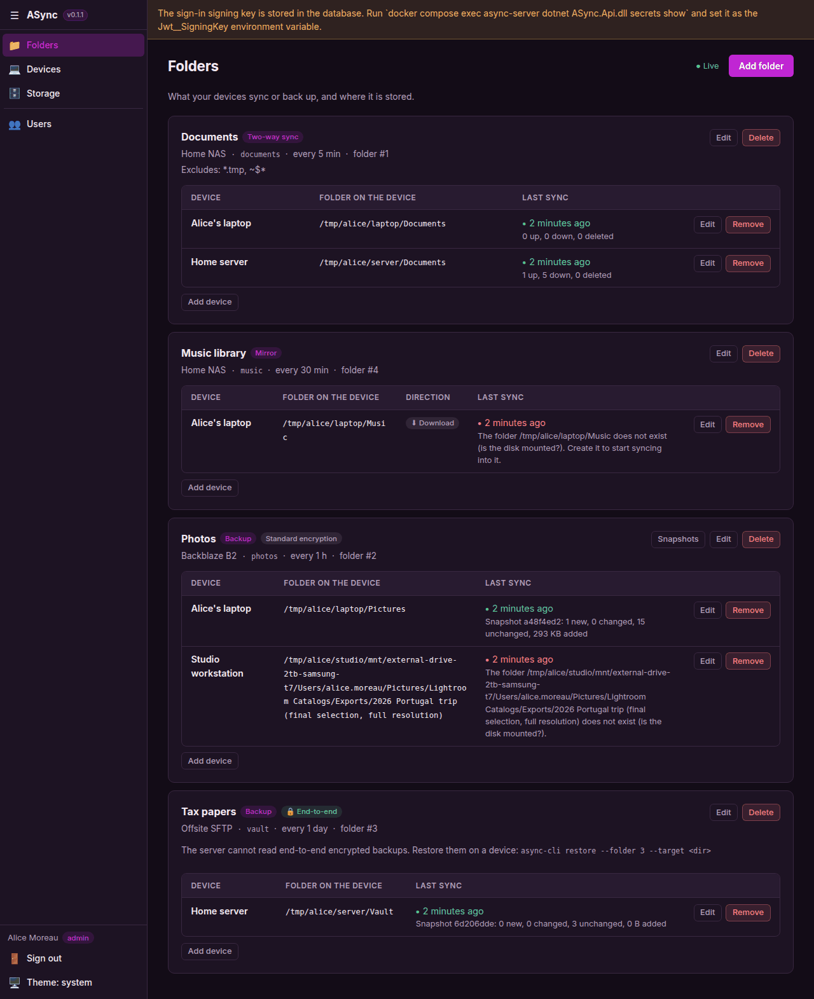
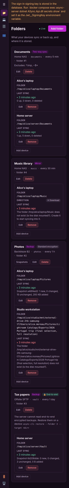

# ASync

Self-hosted sync and backup for all your devices: Windows, macOS, Linux, iOS and Android. One server, many
users, each with their own storage: local disk, S3-compatible, WebDAV/Nextcloud, SFTP or SMB.

> **Status: early development.** The server, the web UI (folders, devices, storage, snapshot browsing) and the
> headless CLI agent work: devices sync and back up folders through the server today. The desktop and mobile
> apps are next. The current version is in [VERSION](VERSION), changes are in
> [RELEASE_NOTES.md](RELEASE_NOTES.md), and the design, roadmap and known gaps are in [AGENTS.md](AGENTS.md).

<p>
  
  
</p>

## What works today

- **Accounts:** the first account becomes admin, and admins create the others. Optional single sign-on
  through any OpenID Connect provider (Authentik, Keycloak, Entra ID…).
- **Adding devices:**
  - **Phones and computers:** *Devices → Add device* shows a QR code and a short code. Scan it or type it in
    the app.
  - **Servers and CLI agents:** the agent prints a short code and a link. Open the link, check the code and
    approve.
  - **Scripted installs:** make a reusable code (valid up to 30 days) and give it to many agents.
- **Device security:**
  - Each device has its own key pair, and the private key never leaves the device (it is hardware-backed
    where the OS supports it).
  - Removing a device in the web UI cuts it off immediately.
- **Storage:** each user adds where their data goes: S3-compatible (AWS, Backblaze B2, Cloudflare R2, Wasabi,
  MinIO…), WebDAV/Nextcloud, SFTP or SMB.
  - Admins can also add directories on the server itself and shared storage. Each user gets their own area
    on shared storage.
  - Connections are tested before saving.
  - Passwords and keys are stored encrypted and never shown again.
- **Folders in the web UI:** *Folders* lists what is synced or backed up, where it is stored, and how each
  device's last sync went. The list updates live as devices report.
  - Add and edit folders (Backup, Mirror or two-way), then attach devices with their local folder. Mirror
    folders also get a direction for each device. Devices can be paused.
  - If someone else changed a folder while you were editing it, you are asked to reload instead of
    overwriting their change.
  - End-to-end encrypted folders show the command that sets them up on a device.
  - Backup folders show when their space was last freed and when they were last verified. A failed
    verification is shown in red with what was found.
- **Recovery keys for standard-encryption backups:** a new Backup folder with standard encryption shows its
  recovery key once. Keep it somewhere safe, away from the server. With it and the storage, the backups can
  be restored with no server at all (`async-cli restore --repo …`, below), and a new server can take them over
  with their history: add a Backup folder on the same storage and directory, tick "take them over" and enter
  the key. *Recovery key* on a folder makes a new key after you re-enter your password; the previous one then
  stops working. Folders made before recovery keys existed show a notice until they get one.
- **Restoring from the browser:** for Backup folders with standard encryption, *Snapshots* lists every
  backup. Walk through its folders and download single files or whole folders as a ZIP. End-to-end encrypted
  backups can only be read on your devices: restore them with `async-cli restore`.
- **Alerts when something stops:** the server notices on its own when a device has not synced or backed up a
  folder for too long, when its runs keep failing, or when a backup's verification or space freeing failed. It
  tells you by [ntfy](https://ntfy.sh), a webhook or e-mail (see [Alerts](#alerts)): once per problem, again
  when it is fixed, and as a daily reminder while it lasts. The *Folders* page marks such devices *Overdue* or
  *Failing*, and the *Alerts* page lists the open problems. Nothing is needed on the devices, and no push
  service.
- **Web UI:** a sidebar layout with light, dark and system themes, usable on phones too.
  [More screenshots](docs/screenshots/): [snapshot browser](docs/screenshots/light-03-snapshots.png),
  [devices](docs/screenshots/light-06-add-device-qr.png), [storage](docs/screenshots/dark-08-storage.png),
  [phone menu](docs/screenshots/phone-02b-sidebar-open.png).
- **Sync engine** (used by the CLI agent today, and by the apps to come):
  - **Backups:** deduplicated, compressed, always encrypted snapshots, with retention rules. Old snapshots
    are dropped after each backup.
  - **Housekeeping, without anyone asking:** the space of dropped snapshots is freed (pruned) every 7 days,
    and every 30 days the backups are verified: that nothing is missing, and that a sample of the stored data
    (10%) still reads back correctly. Both schedules and the sample size are set per folder in the folder
    form; 0 days turns one off.
    - The server does this for folders with standard encryption.
    - For end-to-end encrypted folders one of the folder's devices does it (a running `async-cli run` that
      has the folder unlocked), because only devices have the key.
    - Either waits while a backup or a download is using the folder, and tries again later.
  - **Mirror and two-way folders:** stored as normal files, with old versions and a trash.

## Known limits

- **Keep each folder's recovery key.** Day to day, backups with standard encryption are opened with a key
  the server keeps in its PostgreSQL database. If the database is lost, the backups are still readable with
  the folder's recovery key (or with the keys an admin exported with `secrets export-folder-keys`), but not
  without one of them. A database backup is still worth having: it keeps accounts, devices and folder
  settings, which a recovery key does not bring back. End-to-end encrypted backups never depend on the
  server: the passphrase or the recovery key opens them.
- Taking backups over on a new server needs the folder's directory at the same place relative to the
  storage. On *shared* storage each user's area is `users/<id>/`, and a new server may give the person a
  different id: move the directory into their new area first.
- Alerts only know what devices report. A device that is switched off and one that cannot reach the server
  look the same (both are *Overdue*), and a device is never woken up to catch up: push wake-ups come with the
  mobile apps.
- Webhook and ntfy addresses are typed in by users, and the server sends to them as given (only http and https,
  no redirects, 10-second timeout). Like storage back-ends, they can point at machines on the server's own
  network. That is fine when you trust your users; don't offer ASync to strangers without a firewall rule for
  the server's outgoing traffic.
- A scheduled verification reads back only a sample of the data. `async-cli check --read-data 100` reads
  all of it.
- End-to-end encrypted folders are only pruned and verified while one of their devices runs `async-cli run`
  with the folder unlocked.
- Devices that share a Backup folder need roughly correct clocks (within half an hour). A device whose clock
  is far off can take a running backup's lock for an abandoned one.
- Mirror and two-way folders have no file, version or trash browser in the web UI yet.
- Very large files in Mirror and two-way folders are uploaded in one piece, with no resume; on S3 storage
  files over 5 GB fail.

The planned fixes are listed in [AGENTS.md](AGENTS.md) under "Before M3: gaps to close".

## Run it

```bash
docker compose up -d --build
```

Open http://localhost:5100 and create the admin account. Settings are environment variables on the
`async-server` service, documented inline in [docker-compose.yml](docker-compose.yml):

| Variable | Purpose |
|---|---|
| `PublicUrl` | Address devices use to reach the server (QR codes, approval links). Set it behind a reverse proxy. |
| `TrustForwardedHeaders` | `true` behind a reverse proxy, so client IPs and `https` are seen correctly. |
| `Jwt__SigningKey` | Key that signs sign-in tokens (32+ random characters). Unset = generated and stored in the database, with a warning. |
| `Oidc__Authority`, `Oidc__ClientId`, `Oidc__ClientSecret` | Turn on single sign-on. Redirect URI: `{PublicUrl}/api/auth/oidc/callback`. |
| `Oidc__DisplayName` | Text on the sign-in button. |
| `Oidc__AutoCreateUsers` | `true` (default): a new SSO user gets an account on first sign-in. |
| `Storage__LocalRoots` | Where admins may create back-ends on the server's own disk (default `/data`, the `async_data` volume). Comma-separated. |
| `Maintenance__PollSeconds` | How often the server looks for Backup folders due for pruning or verifying (default 900). |
| `Maintenance__Enabled` | `false` stops the server from pruning and verifying on its own. |
| `Alerts__MinimumGraceMinutes`, `Alerts__GraceFactor` | A device is overdue after the longer of these minutes (default 240) and its folder's interval times the factor (default 3) without a successful run. People can change both for themselves. |
| `Alerts__FailureThreshold`, `Alerts__ReminderHours` | Failed runs in a row before a device counts as failing (default 3); how often open problems are repeated (default 24, 0 = never). Also per person. |
| `Alerts__PollSeconds`, `Alerts__Enabled` | How often the server looks for problems (default 300); `false` turns alerts off. `Alerts__RetryMinutes` (15): wait after a message no channel took. |
| `Smtp__Host`, `Smtp__Port`, `Smtp__Username`, `Smtp__Password`, `Smtp__From`, `Smtp__Security` | The mail account for e-mail alerts. Without `Smtp__Host` and `Smtp__From`, e-mail is not offered. Port 465 uses TLS on connect, others STARTTLS; `Smtp__Security=None` for a local relay. |
| `Push__Mode` | How the server wakes devices. Only `None` (the default) exists so far; alerts and every device's own schedule work without push. |

To move a generated signing key into the environment:

```bash
docker compose exec async-server dotnet ASync.Api.dll secrets show
```

For disaster recovery, an admin can also export the keys of every folder with standard encryption:

```bash
docker compose exec async-server dotnet ASync.Api.dll secrets export-folder-keys > folder-keys.txt
```

Each `folder-<id>=…` line opens that folder's backups offline, like its recovery key. The file can read all of
those backups, so keep it as carefully as the backups themselves, and away from the server. Keys of folders
created later are not in it: export again from time to time. People's own recovery keys work without it.

Always put the server behind HTTPS (a reverse proxy such as Caddy or Traefik) before devices connect over
the internet.

## Alerts

The server checks every few minutes whether each device keeps up with each of its folders. Problems:

- **Overdue:** no successful sync or backup for longer than the grace: 4 hours, or 3 times the folder's
  interval if that is longer (a daily backup is overdue after 3 days). A device that never synced counts from
  when it was attached, a resumed one from when it was resumed. Paused and removed devices are not watched.
- **Failing:** the last 3 runs failed, or it has been failing for longer than the grace.
- **Verification failed / freeing space failed** for a Backup folder.

Each problem is announced once and again when it is fixed ("back to normal"); while problems stay open they are
repeated once a day. One message covers all your folders. After a server restart, new *Overdue* alerts wait a
grace period, because devices could not sync while the server was down. Change the rules for yourself on the
*Alerts* page; the defaults are the `Alerts__*` settings above.

Add channels on the *Alerts* page, each with a *Send test* button:

- **ntfy:** a server (`https://ntfy.sh` or your own) and a topic, plus an access token for protected topics.
  Install the ntfy app and subscribe to the topic. On ntfy.sh, pick a topic name nobody can guess.
- **Webhook:** any http(s) URL, with an optional `Authorization` header value (e.g. `Bearer …`).
- **E-mail:** your address. The server needs the `Smtp__*` settings.

Tokens and headers are stored encrypted and never shown again. A webhook receives a JSON `POST`:

```json
{
  "version": 1,
  "event": "alert",
  "title": "ASync: 1 new problem, 1 back to normal",
  "text": "New problem:\n• \"photos\" on laptop is overdue. No successful run since 2026-11-12 08:00 UTC (expected at least every 4 h).\n\n…",
  "server": "https://sync.example.com",
  "user": "alice",
  "sentAt": "2026-11-14T08:05:00Z",
  "reminder": false,
  "opened":   [ { "id": 7, "kind": "overdue", "folderId": 3, "folderName": "photos", "deviceId": "0196…", "deviceName": "laptop",
                "detail": "No successful run since …", "openedAt": "2026-11-14T08:05:00Z", "resolvedAt": null } ],
  "resolved": [ { "id": 5, "kind": "checkFailed", "folderId": 4, "folderName": "documents", "deviceId": null, "deviceName": null,
                "detail": "The integrity check … found problems: …", "openedAt": "…", "resolvedAt": "2026-11-14T08:05:00Z" } ],
  "open":     [ "…every problem still open, the new ones included…" ]
}
```

- `event` is `alert`, or `test` for *Send test* (with empty lists).
- `kind` is `overdue`, `failing`, `checkFailed` or `pruneFailed`. `deviceId` and `deviceName` are null for
  folder problems.
- `reminder` is true when the message only repeats what is still open.
- `server` is `PublicUrl`, or null when that is not set (then messages carry no link).
- Any 2xx answer counts as delivered. Redirects are not followed, and the server waits at most 10 seconds.
  When no channel takes a message, it is tried again after 15 minutes.

ntfy gets the same title and text, with high priority for new problems.

## Run an agent

`async-cli` is the headless agent for servers, NAS boxes and other machines without a screen. It syncs and
backs up the folders you assign to it in the web UI.

### In Docker

Make a code in *Devices → Add device* (a reusable one works for many agents), then:

```bash
docker run -d --name async-agent --restart unless-stopped \
  -e ASYNC_SERVER=https://sync.example.com \
  -e ASYNC_ENROLL_CODE=K7QD-M2XP-9RWA \
  -e ASYNC_DEVICE_NAME=nas \
  -v async-agent-config:/config \
  -v /srv/photos:/data/photos \
  <dockerhub-user>/async-cli:latest
```

On first start the agent enrolls itself; after that the code is no longer needed. Then attach folders to the
device in the web UI, with local paths as the container sees them (`/data/photos`). The image is built from
[Dockerfile.cli](Dockerfile.cli) for amd64 and arm64; there is a commented-out `async-cli` service in
[docker-compose.yml](docker-compose.yml) as well.

- **Keep the `/config` volume.** It holds the device's key, unlocked end-to-end keys and the sync state.
  Without it the agent has to be enrolled again.
- The agent runs as uid 1654. Mounted folders must be readable by it, and writable for TwoWay folders and
  Mirror folders that download. Or run it as your own user with `--user $(id -u):$(id -g)`.

### Without Docker

Build it with the .NET 10 SDK (`dotnet publish src/ASync.Cli -c Release -o ~/async-cli`) and run
`~/async-cli/async-cli`. Its identity lives in `~/.config/async`, or in `ASYNC_CONFIG_DIR`, or in `--config <dir>`.

```bash
async-cli enroll --server https://sync.example.com --code K7QD-M2XP-9RWA   # or without --code: approve a link
async-cli run                                                                # keep syncing (Ctrl+C stops)
```

### Commands

| Command | What it does |
|---|---|
| `enroll` | Adds this machine to your account: with `--code`, or by showing a link and code to approve in the web UI. |
| `status`, `folders` | This device, and the folders assigned to it. |
| `sync [--folder N]` | Syncs (or backs up) every folder, or one, once. |
| `run` | Keeps syncing: on schedule, when files change, and as soon as another device changes a folder. The default in Docker. |
| `set-path`, `pause`, `resume` | Changes this device's settings for a folder. |
| `init-encryption --folder N` | Sets up an end-to-end encrypted Backup folder (on one device) and prints its recovery key. |
| `unlock --folder N` | Unlocks an end-to-end encrypted folder on another device, with the passphrase or the recovery key. |
| `snapshots`, `restore` | Lists a Backup folder's snapshots, and restores one (or `--path` a part of it) into `--target`. `--snapshot` takes the short id that `snapshots` and the web UI show (the id's last 8 digits), the start of the id, or `latest`. |
| `snapshots --repo <dir>`, `restore --repo <dir>` | The same **without a server**, straight from the storage: `--repo` is the folder's directory (a local disk, a mounted share or a copy). For S3, WebDAV, SFTP or SMB add `--storage settings.json` (the connection settings, see below) and give the directory on that storage as `--repo`. Opens with the recovery key, an end-to-end passphrase, or an exported folder key, from `--key-file`, `ASYNC_RECOVERY_KEY` or typed in. Needs no enrolment. |
| `prune [--folder N]` | Frees the space of dropped snapshots in a Backup folder (or in all of this device's) now, and says what was removed and how much was freed. |
| `check [--folder N] [--read-data <percent>]` | Verifies a Backup folder (or all of this device's): nothing missing, and with `--read-data` that this share of the stored data reads back correctly (100 = everything). Lists the problems and exits with code 1 when it finds any. |
| `forget` | Removes this device's identity from the machine. |

Passphrases are read from `ASYNC_PASSPHRASE`, from `--passphrase-file`, or typed in. A sync that would delete
more than half of a folder's files stops; run it with `--allow-mass-delete` if that is what you want. Removing
the device in the web UI cuts it off at once: a running agent stops with an explanation. `prune` and `check`
work on standard and end-to-end folders alike; their results appear on the *Folders* page. Both say "BUSY"
and exit with code 1 when a backup or another prune is using the folder: run them again later.

### Restoring without the server

You need the folder's directory on the storage (the web UI shows it with the recovery key: on shared storage it
is inside `users/<id>/`) and its recovery key. Nothing else: no server, no database, no enrolled device.

```bash
async-cli snapshots --repo /mnt/backup-disk/photos                 # asks for the recovery key
async-cli restore --repo /mnt/backup-disk/photos --target ~/photos --snapshot latest

# On remote storage: the connection settings as JSON (the same fields as in the web UI's storage form)
cat > s3.json <<'EOF'
{ "type": "S3", "endpoint": "https://s3.example.com", "region": "us-east-1", "bucket": "backups",
  "prefix": "async", "accessKeyId": "…", "secretAccessKey": "…", "forcePathStyle": true }
EOF
ASYNC_RECOVERY_KEY=ABCD-EFGH-… async-cli restore --storage s3.json --repo photos --target ~/photos
```

The `type` is `S3`, `WebDav` (`url`, `username`, `password`), `Sftp` (`host`, `port`, `username`, `password` or
`privateKey`, `path`, optionally `hostKeyFingerprint`) or `Smb` (`host`, `share`, `path`, `username`,
`password`). Without a `hostKeyFingerprint` an SFTP server's key is accepted as it is.

## Development

See [CLAUDE.md](CLAUDE.md) for commands and rules, and [AGENTS.md](AGENTS.md) for the architecture.
`scripts/e2e-sync.sh` runs the end-to-end sync test: a throw-away server stack on port 5190 and real agents.
