# ASync

Self-hosted sync and backup for all your devices: Windows, macOS, Linux, iOS and Android. One server, many
users, each with their own storage: local disk, S3-compatible, WebDAV/Nextcloud, SFTP or SMB.

> **Status: early development.** The server, the web UI (folders, devices, storage, snapshot and file browsing), the
> headless CLI agent and the desktop app (Linux; built for Windows and macOS, not tried there yet) work: devices sync
> and back up folders through the server today. Desktop installers with self-update are built for every release (tried
> on Linux; not code-signed yet). The Android app (an APK to sideload) syncs and backs up in the background too, and the
> server can wake it through UnifiedPush (ntfy). The iOS app (an .ipa to sideload) enrolls and syncs, also in the background as
> far as iOS allows. The current version is in [VERSION](VERSION), changes are in
> [RELEASE_NOTES.md](RELEASE_NOTES.md), and the design, roadmap and known gaps are in [AGENTS.md](AGENTS.md).

<p>
  
  
</p>

## What works today

- **Accounts:** the first account becomes admin, and admins create the others. Optional single sign-on
  through any OpenID Connect provider (Authentik, Keycloak, Entra ID…).
  - *Account* (in the sidebar) changes your own password: enter the current one, and every other browser
    you are signed in with is signed out (this one stays; devices keep syncing). Accounts that only use single
    sign-on have no password here: change it at your identity provider, or ask an admin to set one.
  - Admins delete accounts on *Users*. The confirmation lists what goes with it: the person's devices (removed
    at once, so their running agents stop), folders, personal storage, alert channels, enrollment codes and
    browser sessions. Shared storage stays. The stored data of their folders stays too, unless you tick
    *Also delete the stored data* and type the username. You cannot delete yourself or the last admin.
- **Adding devices:**
  - **Phones and computers:** *Devices → Add device* shows a QR code and a short code. Scan it or type it in
    the app.
  - **Servers and CLI agents:** the agent prints a short code and a link. Open the link, check the code and
    approve.
  - **Scripted installs:** make a reusable code (valid up to 30 days) and give it to many agents.
- **Device security:**
  - Each device has its own key pair, and the private key never leaves the device (it is hardware-backed
    where the OS supports it).
  - Removing a device in the web UI cuts it off immediately.
- **Storage:** each user adds where their data goes: S3-compatible (AWS, Backblaze B2, Cloudflare R2, Wasabi,
  MinIO…), WebDAV/Nextcloud, SFTP or SMB.
  - Admins can also add directories on the server itself and shared storage. Each user gets their own area
    on shared storage.
  - Connections are tested before saving, and every hour after that: storage that stops answering gets you an
    alert (admins, for shared storage), and another one when it works again.
  - Passwords and keys are stored encrypted and never shown again.
- **Storage use and quotas:** *Folders* and *Storage* show how much your folders take on their storage, per folder
  (with the part that is old versions and trash, or, for backups, how much data the snapshots hold after
  deduplication) and per storage. Admins set a quota per user on *Users*, and on shared storage how much each
  user may keep there. Near the quota (90%) you get an alert; over it, new uploads are refused, so devices report
  a failed sync and you get an alert. Deleting, restoring and downloading always work. See
  [Quotas and storage health](#quotas-and-storage-health).
- **Folders in the web UI:** *Folders* lists what is synced or backed up, where it is stored, and how each
  device's last sync went. The list updates live as devices report.
  - Add and edit folders (Backup, Mirror or two-way), then attach devices with their local folder. Mirror
    folders also get a direction for each device. Devices can be paused.
  - **Wait after changes** (two-way and mirror folders): how long a device waits after you change files before it
    syncs them: *Immediately* (a few seconds, the default), 1, 5, 15 or 30 minutes. Every change restarts the wait, so a burst
    of saves becomes one sync, but files that keep changing still sync at the latest after a cap (10 minutes, or four times
    the wait: 2 hours for 30 minutes). Longer waits mean fewer runs and fewer stored versions of files you save constantly (a
    work folder), but on two-way folders more chance of a conflict with another device that edits the same file meanwhile.
    A file that changed within the wait is left for the next run even when something else starts one (the interval, or
    another device's change), up to the same cap; *Sync now* on a device takes everything as it is. While changes wait, the
    device's row on *Folders* and the folder in the apps say *Changes waiting* and when they will sync.
  - **Browse…** next to the local folder picks it on the device itself instead of typing the path: see
    [Choosing a device's folder from the web](#choosing-a-devices-folder-from-the-web).
  - Folders can also be created from the apps, which then show *added from <device>*: see
    [Adding folders from the apps](#adding-folders-from-the-apps).
  - **Photos & videos** folders back up a phone's photo library, all of it or chosen albums: see
    [Backing up photos and videos](#backing-up-photos-and-videos).
  - **Contacts** and **Calendars** folders back up a phone's contacts (as vCards) and calendars (as iCalendar events), all
    of them or chosen accounts and calendars: see [Backing up contacts and calendars](#backing-up-contacts-and-calendars).
  - If someone else changed a folder while you were editing it, you are asked to reload instead of
    overwriting their change.
  - End-to-end encrypted folders show the command that sets them up on a device.
  - *Delete* stops syncing a folder everywhere. Its stored data stays on the storage unless you tick *Also
    delete the stored data* and type the folder's name: then the server empties the folder's directory (and
    nothing outside it) in the background, and the page shows how many files and bytes it removed. That is
    refused while a device is syncing the folder; try again a moment later. When a standard-encryption backup's
    data is kept, its recovery key is then the only way to open it.
  - Backup folders show when their space was last freed and when they were last verified. A failed
    verification is shown in red with what was found.
- **Recovery keys for standard-encryption backups:** a new Backup folder with standard encryption shows its
  recovery key once. Keep it somewhere safe, away from the server. With it and the storage, the backups can
  be restored with no server at all (`async-cli restore --repo …`, below), and a new server can take them over
  with their history: add a Backup folder on the same storage and directory, tick "take them over" and enter
  the key. *Recovery key* on a folder makes a new key after you re-enter your password; the previous one then
  stops working. Folders made before recovery keys existed show a notice until they get one.
- **Restoring from the browser:** for Backup folders with standard encryption, *Snapshots* lists every
  backup. Walk through its folders and download single files or whole folders as a ZIP. End-to-end encrypted
  backups can only be read on your devices: restore them with `async-cli restore`.
- **Files, old versions and the trash of Mirror and two-way folders:** *Files* on such a folder shows what is on
  the storage now. Walk through its folders, download a file or a whole folder as a ZIP.
  - *Versions (n)* next to a file lists the copies that were replaced, with their time and size. Download one,
    or restore it: the current file is then kept as a version too, so nothing is lost. The *Versions* tab lists
    every file that has old versions, including deleted ones.
  - *Trash* lists deleted files grouped by when they were deleted. Download or restore them (one, or a whole
    group) to where they were. If a file of that name exists again, you choose: keep both (the restored one
    gets a name like `report (restored 2026-11-14 1203).pdf`) or replace the current one (which becomes a
    version). *Empty trash* deletes it all for good, after asking.
  - A restore never runs at the same time as a device's sync: while a device is syncing the folder it is refused ("… is syncing this folder
    right now"), so try again a moment later. Afterwards the folder's devices are told at once, and two-way and
    Mirror *Download* devices fetch the restored files. A Mirror *Upload* device makes the storage equal to its
    own folder, so it undoes a restore on its next run: the page warns about that.
- **Alerts when something stops:** the server notices on its own when a device has not synced or backed up a
  folder for too long, when its runs keep failing, when a backup's verification or space freeing failed, when
  storage stops answering, or when a quota is nearly or completely full. It
  tells you by [ntfy](https://ntfy.sh), a webhook or e-mail (see [Alerts](#alerts)): once per problem, again
  when it is fixed, and as a daily reminder while it lasts. The *Folders* page marks such devices *Overdue* or
  *Failing*, and the *Alerts* page lists the open problems. Nothing is needed on the devices, and no push
  service.
- **Web UI:** a sidebar layout with light, dark and system themes, usable on phones too.
  [More screenshots](docs/screenshots/): [snapshot browser](docs/screenshots/light-03-snapshots.png),
  [files and versions](docs/screenshots/light-11-files.png), [trash](docs/screenshots/dark-11-files-trash.png),
  [files on a phone](docs/screenshots/phone-04-files.png),
  [devices](docs/screenshots/light-06-add-device-qr.png), [storage](docs/screenshots/dark-08-storage.png),
  [phone menu](docs/screenshots/phone-02b-sidebar-open.png), [storage use](docs/screenshots/light-12-folders-usage.png),
  [storage health](docs/screenshots/dark-13-storage-health.png), [quotas](docs/screenshots/light-14-users-quotas.png),
  [quota and storage alerts](docs/screenshots/phone-15-alerts-quota-storage.png).
- **Sync engine** (used by the CLI agent today, and by the apps to come):
  - **Backups:** deduplicated, compressed, always encrypted snapshots, with retention rules. Old snapshots
    are dropped after each backup. A backup that finds nothing changed since the last snapshot makes no new one (the run
    says "No changes since snapshot …" and counts as a successful backup), so the newest snapshot is the last time something
    changed, and an unchanged folder neither fills the snapshot list nor wears the device's storage.
  - **Housekeeping, without anyone asking:** the space of dropped snapshots is freed (pruned) every 7 days,
    and every 30 days the backups are verified: that nothing is missing, and that a sample of the stored data
    (10%) still reads back correctly. Both schedules and the sample size are set per folder in the folder
    form; 0 days turns one off.
    - The server does this for folders with standard encryption.
    - For end-to-end encrypted folders one of the folder's devices does it (a running `async-cli run` that
      has the folder unlocked), because only devices have the key.
    - Either waits while a backup or a download is using the folder, and tries again later.
  - **Mirror and two-way folders:** stored as normal files, with old versions and a trash.

### Choosing a device's folder from the web

<p>
  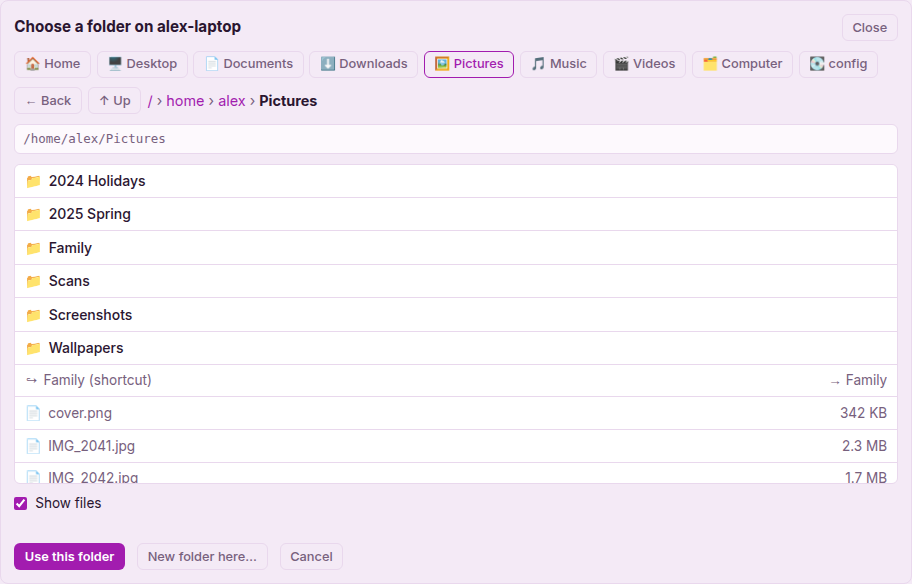
  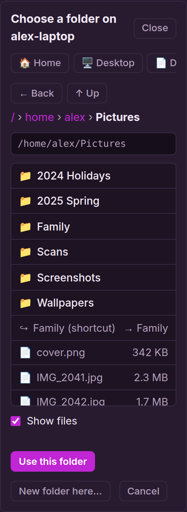
</p>

When you attach a device to a folder (or change where it syncs), *Browse…* next to *Folder on the device* opens a
picker in which the device itself lists its folders, live:

- **Starting points:** your home, Desktop, Documents, Downloads, Pictures, Music and Videos; the drives on Windows;
  `/` and mounted disks on Linux (USB disks, `/mnt/…`, a container's volumes such as `/data`) and macOS (`/Volumes`); on a
  phone the internal storage, SD cards and USB drives, Download, DCIM, Pictures and Documents.
- **Moving around:** click a folder to open it; ← Back, ↑ Up and the breadcrumbs go back. Files are shown greyed with
  their size so you recognise the place (*Show files* hides them); hidden files and folders are behind *Show hidden*.
  Links are shown with where they point but not opened; folders the device cannot read have a 🔒. A very full folder
  shows its first 2000 entries and "… and N more".
- **New folder here…** creates a folder on the device; **Use this folder** puts its path into the form.
- **When it cannot work:** the device must be online, with its app or agent running (it answers within 10 seconds).
  A phone that Android put to sleep is woken first when it has [wake-ups](#background-sync-on-android) (UnifiedPush):
  the picker says "Waking…" and that can take up to 30 seconds. A phone needs
  [All files access](#folders-anywhere-on-the-phone) (otherwise choose the folder in the app). The *Devices* page shows per
  device whether browsing is available, and why not. You can always type the path instead.

Nothing is stored: the server passes the listing from the device to your browser. Only you can browse your devices
(not other people, admins included, and not devices themselves). To turn it off for a device: *Settings → Allow browsing
folders from the web* in the desktop or Android app, or `async-cli browsing --off`; `async-cli run --no-browse` or
`ASYNC_ALLOW_BROWSE=0` (e.g. in the Docker image's environment) keeps it off for that agent, whatever the setting.
An agent's own config directory (the Docker image's `/config`, which holds the device's key) is never offered as a
starting point.

### Adding folders from the apps

<p>
  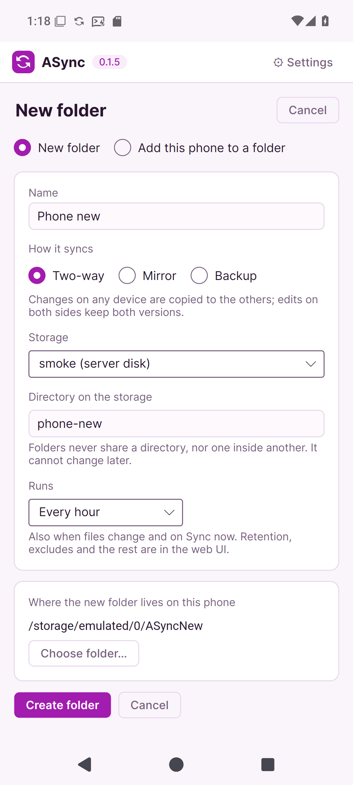
  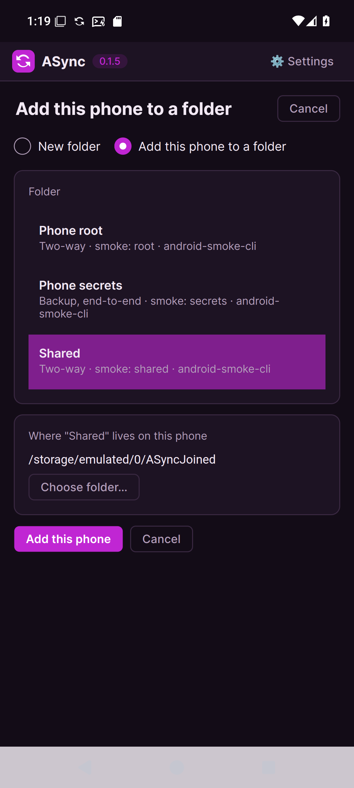
  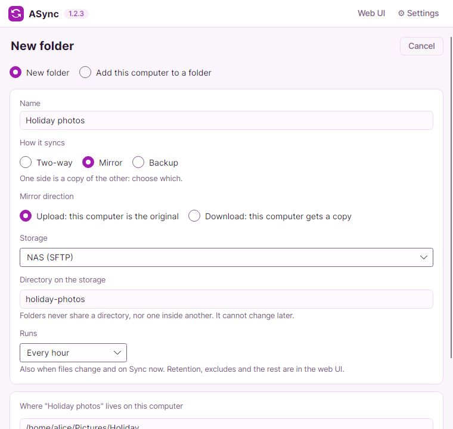
</p>

You don't need a computer to start syncing a new folder from your phone. The Android and desktop apps have:

- **New folder…** above the folder cards: a name; *Two-way*, *Mirror* (and which side is the original) or *Backup*;
  end-to-end encryption for backups; which of your storage to put it on; the directory there (filled in from the name);
  how often it runs; how long it waits after local changes (two-way and mirror, see *Wait after changes* above); and where it
  lives on the device, chosen with the folder picker (on a phone with
  [All files access](#folders-anywhere-on-the-phone) anywhere on the phone, otherwise with Android's picker). A new
  end-to-end backup asks for its passphrase right away and shows its recovery key once; a standard backup shows its
  recovery key once.
- **Add to a folder…**: pick one of your folders this device is not part of yet (it shows its mode, storage and
  devices), then where it lives here. An end-to-end folder then asks for its passphrase to unlock it.

The folder follows the same rules as in the web UI (no folder inside another on the same storage, only storage you may
use) and appears there at once, marked *added from <device>*; retention, excludes and the other settings, and deleting
it, are done in the web UI as usual.

<p>
  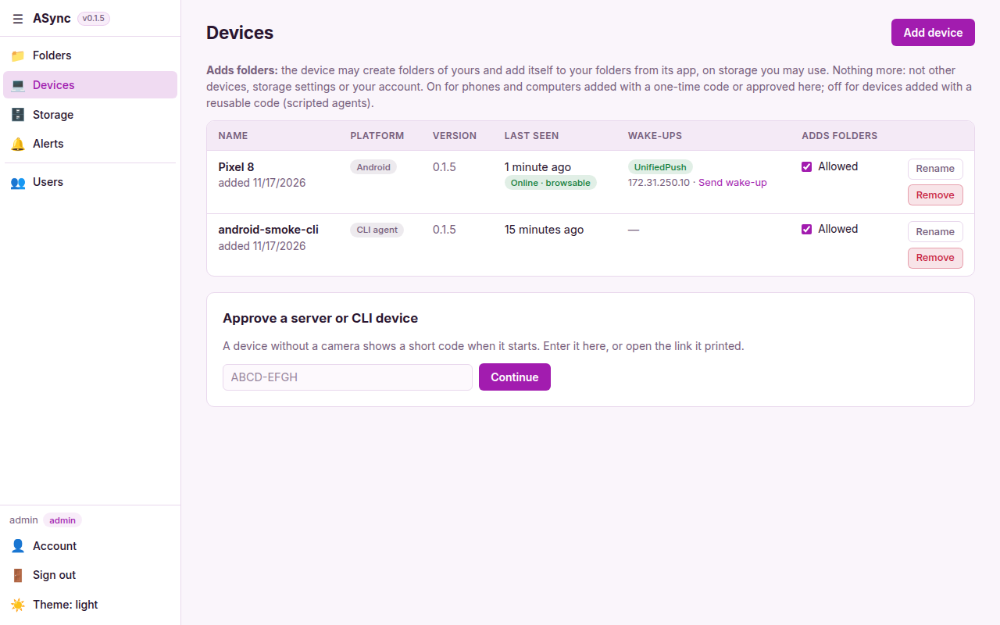
  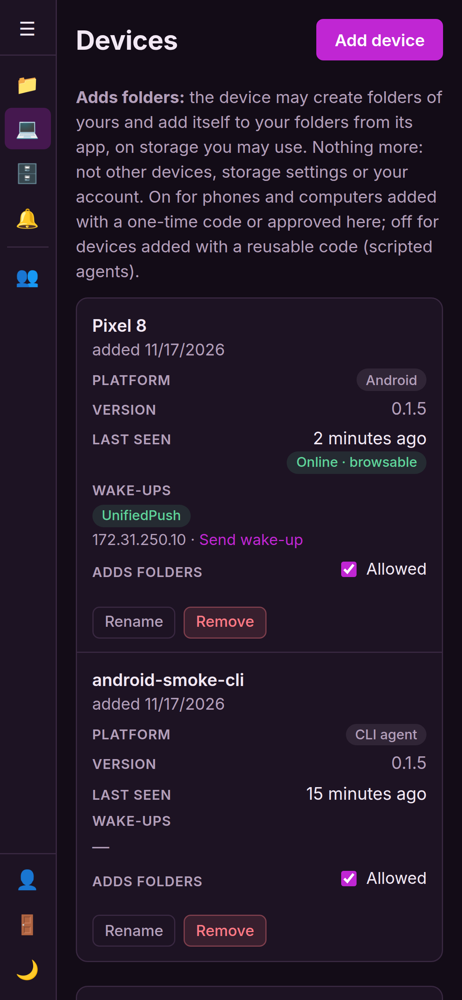
</p>

**Which devices may do it** is up to you: the *Devices* page has *Adds folders* per device. It is on for phones and
computers you added with a one-time code or approved in the browser, and off for devices added with a reusable code
(scripted agents) and for devices added before this version. When it is off, the app says *Allowed in the web UI under
Devices*. A device can only ever add *itself* to your folders, never another device, and it never sees your storage's
settings or passwords, other people's folders, or your account.

### Backing up photos and videos

<p>
  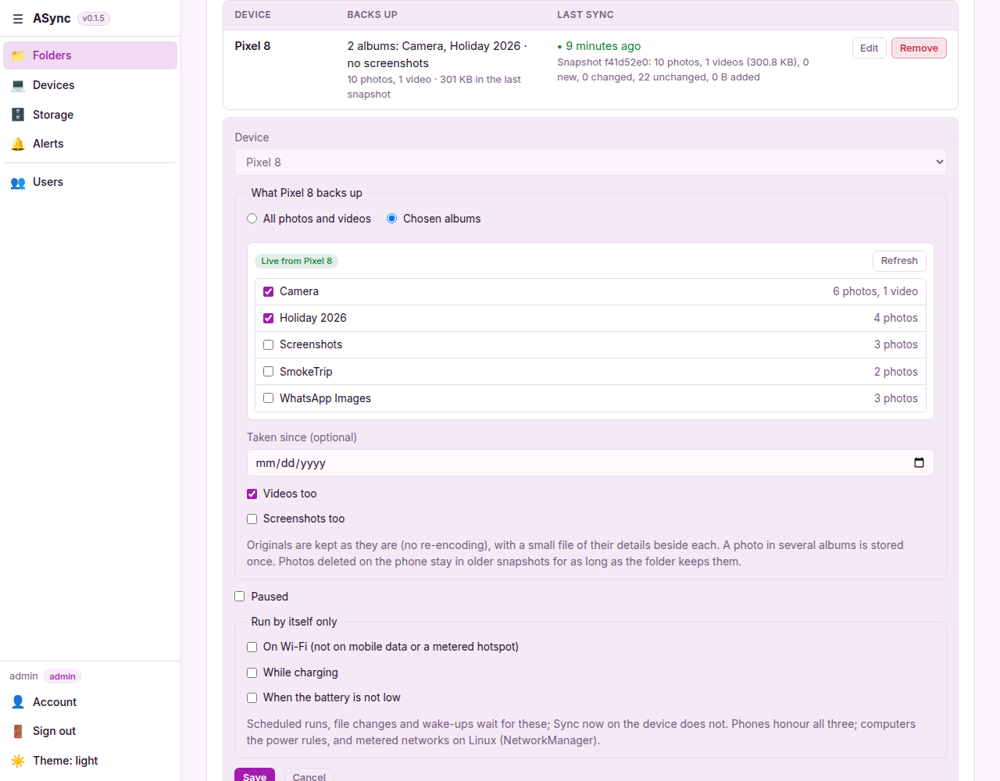
  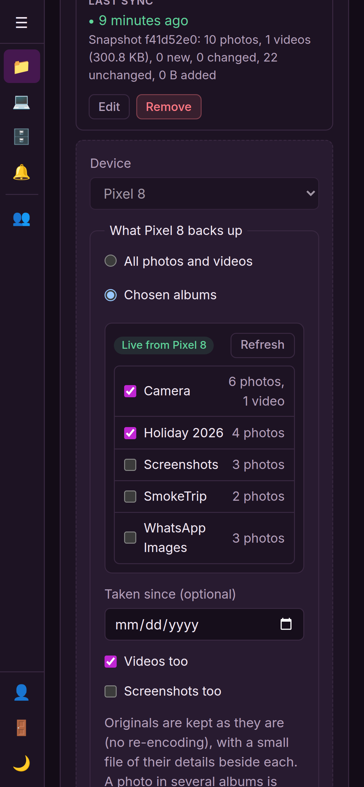
</p>
<p>
  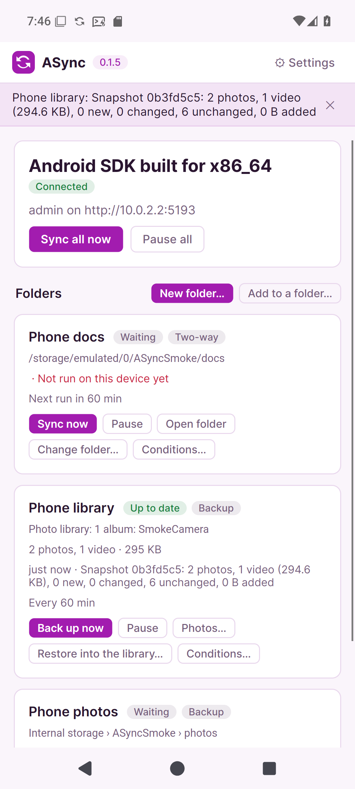
  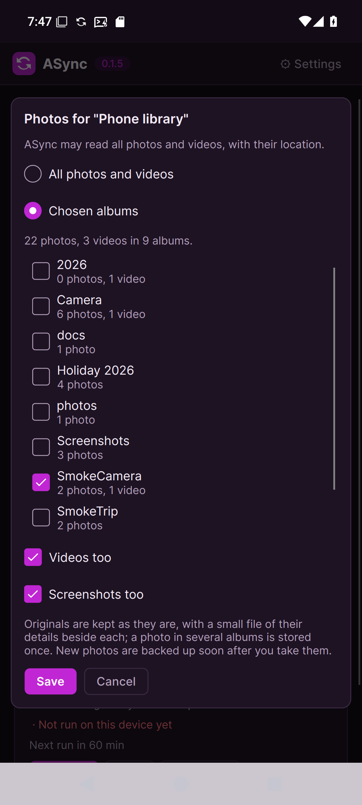
  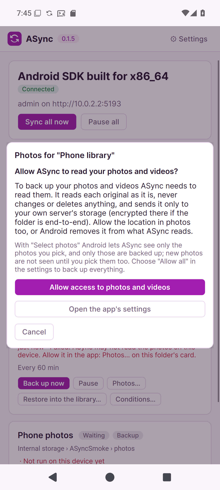
  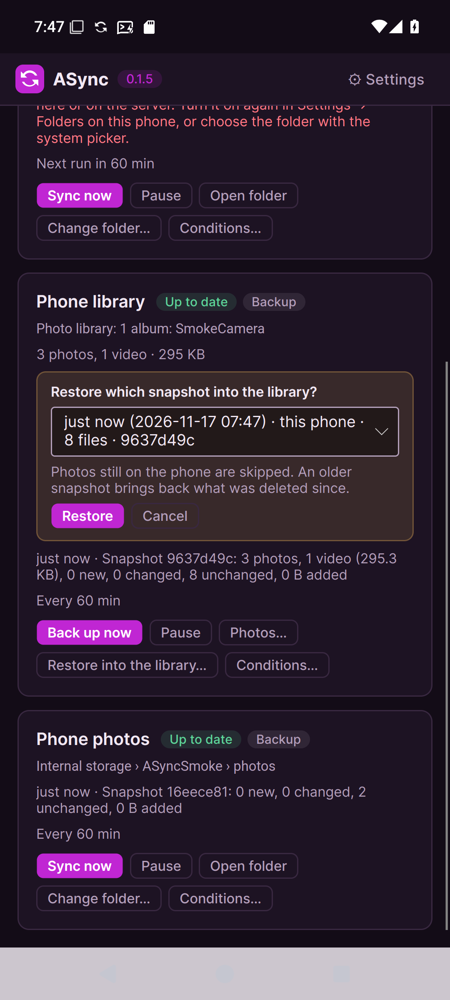
</p>
<p>
  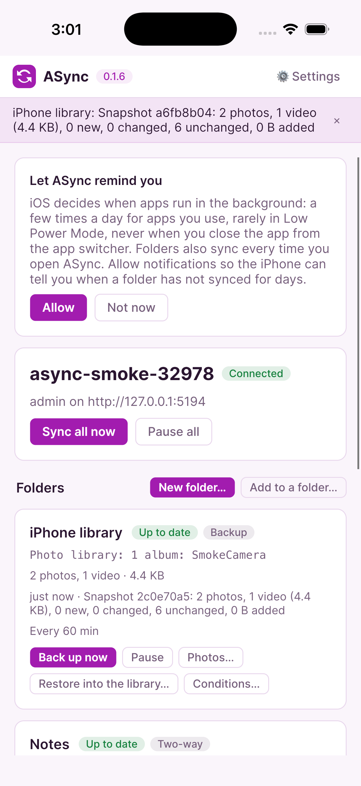
  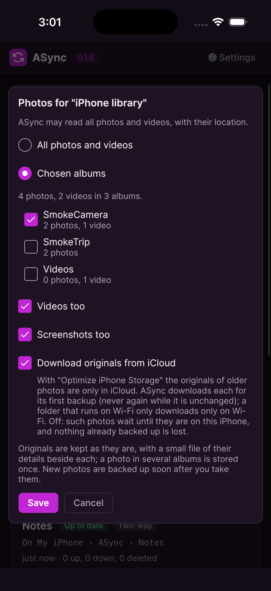
  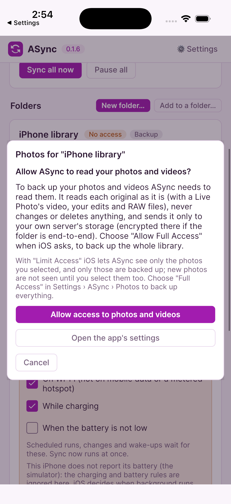
  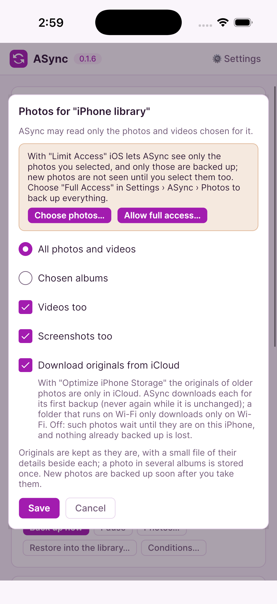
</p>

A **Photos** folder backs up a phone's photo library instead of a directory: every photo and video, or only the albums
you choose.

1. *Folders → Add folder → Photos & videos* (or *New folder… → Photos & videos* in the phone's app). It is a backup
   folder like the others: snapshots, how many to keep, standard or end-to-end encryption, a recovery key.
2. Add your phone to it. Instead of a folder on the device you choose **what it backs up**: *All photos and videos*, or
   *Chosen albums*. The album list comes from the phone itself (it is asked live, and woken if it is asleep and has
   UnifiedPush); when the phone is offline you see the list it reported last. You can also leave out videos or
   screenshots, or start from a date. Several phones can share one Photos folder; each keeps its own snapshots.
3. On the phone, ASync asks once for access to photos and videos and says why (on the Photos screen, never at start). Choose
   *Allow all* on Android, *Allow Full Access* on an iPhone: with Android 14's *Select photos* or the iPhone's *Limit Access*
   only the photos you pick are backed up, and new ones are not seen until you pick them too (the app says so and offers
   *Allow all photos…* / *Allow full access…*, and on the iPhone *Choose photos…* to change the selection). On Android ASync
   also asks for the photos' location, or Android removes it from what ASync reads; an iPhone always gives it.

New photos and videos are backed up soon after you take them (within a minute or so, when the folder's conditions, such
as Wi-Fi only, allow), and every folder also runs on its schedule. **Originals are stored as they are**, not re-encoded,
each with a small `.json` file of its details (when it was taken, its size, dimensions, location, albums, favourite).
They are kept in year and month directories, `2026/03/IMG_1234~1000000033.jpg` (the number after `~` keeps two
`IMG_0001.JPG` apart), so a restore with `async-cli restore`, or a download from the web snapshot browser, gives you plain
files you can open anywhere. A photo in two albums, or renamed, is stored once; unchanged photos are not read again.
Deleting a photo on the phone keeps it in the older snapshots for as long as the folder keeps them.

**Getting them back:** *Restore into the library…* on the folder's card in the phone's app asks which snapshot (the
phone's newest is preselected; an older one brings back photos deleted since) and puts it back into the phone's photos,
each where it was (DCIM/Camera…), skipping what is still there. If an album is emptied on the phone, ASync makes no
empty snapshot: the run says so and the last snapshot keeps the photos. On a computer,
`async-cli restore` (or the web UI's *Snapshots*) gives the files and their `.json` details.

Browsing folders and listing albums from the web are one setting on the phone (*Settings → Allow browsing folders from the web*):
with it off, the web UI shows the last album list the phone reported and you can still choose *All photos and videos*.

**On an iPhone** it works the same way, with what iOS's Photos library has:
- **Albums:** your own albums (also those in folders, and albums synced from a computer) and the useful system albums that have
  something in them: *Favorites*, *Screenshots*, *Videos*, *Selfies*, *Live Photos*, *Portrait*, *Panoramas*, *Slo-mo*,
  *Time-lapse*, *Bursts*, *RAW*, *Long Exposure*, *Animated*, *Cinematic*. A photo in several albums is stored once and its
  `.json` lists them all. Not backed up: *Hidden* photos, *Shared Albums* (they are other people's, at reduced size), *Recently
  Deleted*; of a burst only the photo you chose (or iOS's pick) is backed up.
- **Everything of a photo, as it is:** the original (HEIC, JPEG, ProRAW, MOV…), a Live Photo's video (`IMG_1234~….live.mov`), your
  edit as iOS renders it (`….edited.heic`, the original stays as it was taken) and a RAW kept beside a JPEG (`….raw.dng`).
- **iCloud Photos with "Optimize iPhone Storage":** originals that are only in iCloud are downloaded for their first backup, never
  again while they are unchanged (a favourite or an album change does not read a photo again). A folder that runs on *Wi-Fi only*
  downloads only on Wi-Fi, also when you tap *Back up now*. *Download originals from iCloud* on the Photos screen (on by default,
  for this iPhone) turns that off: such photos then wait until they are on the iPhone. A photo that cannot come down now is simply
  backed up on a later run; the backup says how many wait, and nothing already backed up is lost or taken for deleted.
- **New photos** start a backup within seconds while ASync is open; otherwise they are backed up in iOS's background slots and
  whenever you open ASync (see [Background sync on iOS](#background-sync-on-ios)).
- **Restore into the library** puts each photo back with its date, location and favourite mark, a Live Photo as a Live Photo again
  (with its RAW, where iOS takes it), into the albums it was in (made when missing; the system albums fill by themselves). Photos
  still there are skipped and put back into the albums they had left; restoring twice adds nothing. Edits come back as the
  original (the edit's render stays in the snapshot). iOS gives albums new ids on a new or wiped iPhone, so choose the albums of a
  *Chosen albums* selection again there (or back up *All photos and videos*).

### Backing up contacts and calendars

<p>
  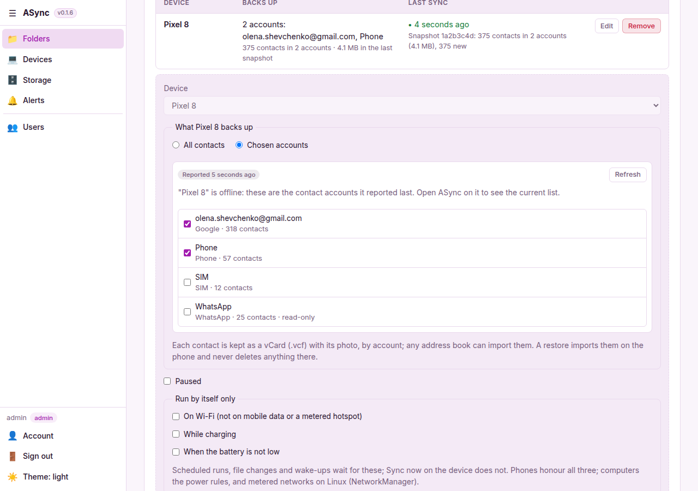
  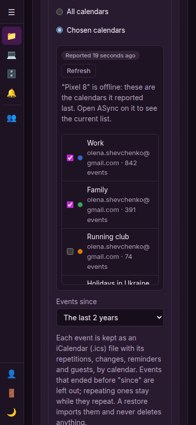
</p>

**Contacts** and **Calendars** folders back up a phone's address book and calendars, chosen the same way as photo albums.

1. *Folders → Add folder → Contacts* or *Calendars* (or *New folder…* in the phone's app). They are backup folders like the
   others: snapshots, how many to keep, standard or end-to-end encryption, a recovery key.
2. Add your phone and choose **what it backs up**: *All contacts* or *Chosen accounts* (your Google account, the phone itself, the
   SIM, an app's account), *All calendars* or *Chosen calendars*, and for calendars *Events since* (the last two years unless you
   choose otherwise; repeating events are kept while they still repeat, future events always). The lists come live from the phone,
   or as it reported them last when it is offline, with how many contacts or events each holds.
3. On the phone, ASync asks once to **read** your contacts or calendars and says why. It asks to **add** to them only when you
   restore.

Changes are backed up soon after you make them (when the folder's conditions allow), and every folder also runs on its schedule.
Each contact is kept as a **vCard 4.0 file with its photo**, by account (`me@gmail.com~1a2b3c4d/Olena Shevchenko~42.vcf`); each event
as an **iCalendar file** with its repetitions, changed or cancelled occurrences, reminders and guests, by calendar
(`Work~4/Standup~118.ics`), with a small `account.json` / `calendar.json` beside them. Unchanged contacts and events are stored once,
and an unchanged contact is not even read again.

**Getting them back:** *Restore into the contacts… / calendars…* on the folder's card asks which snapshot and where to: the accounts
or calendars they came from, or one you choose. Entries still on the phone are skipped, and **nothing on the phone is changed or
deleted**. If an account or calendar is emptied on the phone, no empty snapshot replaces the last good one. On a computer, `async-cli
restore` gives plain `.vcf` and `.ics` files any address book or calendar imports, and the web UI's *Snapshots* downloads them — a
whole account as **one .vcf** and a whole calendar as **one .ics** too.

Listing accounts and calendars from the web is the same phone setting as browsing folders and albums.

**On an iPhone** it works the same way, with iOS's own words and a few limits iOS sets:
- The accounts are where iOS keeps contacts: *iPhone* (on the phone only), *iCloud*, *Exchange* or another CardDAV account; the
  calendars are listed with their account (iCloud, Exchange, the iPhone itself, subscribed calendars, which are backed up but not
  restored into). The *Birthdays* calendar is left out: iOS makes it from the contacts.
- When iOS asks, choose **Allow Full Access**. With *Limited Access* to contacts only the contacts you share with ASync are backed up
  (change it in *Settings › Apps › ASync › Contacts*); calendars' *Add Events Only* is not enough to back anything up. iOS asks once:
  afterwards *Allow* opens ASync's page in Settings. A restore needs no second question.
- **Contacts' notes are not backed up**: iOS gives them only to apps Apple has approved for it. A card's iOS labels (*iPhone*, *Main*,
  *Apple Watch*, your own) and social profiles are kept, and come back as iOS's own labels, also from an Android backup.
- **Guests** are backed up with each event, but an app cannot put them back: a restore adds the events without them. Each event's
  repetitions, the occurrences you moved or deleted, alerts and all-day days come back. Events are backed up up to five years ahead.
- On a new iPhone the accounts and calendars have new identities: a restore goes into the one of the same name (iCloud, say), or
  you choose where.

## Known limits

- **Keep each folder's recovery key.** Day to day, backups with standard encryption are opened with a key
  the server keeps in its PostgreSQL database. If the database is lost, the backups are still readable with
  the folder's recovery key (or with the keys an admin exported with `secrets export-folder-keys`), but not
  without one of them. A database backup is still worth having: it keeps accounts, devices and folder
  settings, which a recovery key does not bring back. End-to-end encrypted backups never depend on the
  server: the passphrase or the recovery key opens them.
- Taking backups over on a new server needs the folder's directory at the same place relative to the
  storage. On *shared* storage each user's area is `users/<id>/`, and a new server may give the person a
  different id: move the directory into their new area first.
- Alerts only know what devices report. A device that is switched off and one that cannot reach the server
  look the same (both are *Overdue*), and a device is never woken up to catch up: push wake-ups come with the
  mobile apps.
- Webhook and ntfy addresses are typed in by users, and the server sends to them as given (only http and https,
  no redirects, 10-second timeout). Like storage back-ends, they can point at machines on the server's own
  network. That is fine when you trust your users; don't offer ASync to strangers without a firewall rule for
  the server's outgoing traffic.
- A scheduled verification reads back only a sample of the data. `async-cli check --read-data 100` reads
  all of it.
- End-to-end encrypted folders are only pruned and verified while one of their devices runs `async-cli run`
  with the folder unlocked.
- Devices that share a Backup folder need roughly correct clocks (within half an hour). A device whose clock
  is far off can take a running backup's lock for an abandoned one.
- The *Files* view shows the storage as it is; a device's changes that have not been synced yet are not there.
  Empty directories are not synced, so they do not show either, and ZIP downloads contain files only.
- Deleting stored data checks the storage settings of every other folder, so two storage entries pointing at the
  same disk, bucket or share cannot lose each other's data. It goes by the settings as typed: an SFTP server
  reached under two host names, or a path relative to two different users' home directories, looks like two
  places.
- After a password change, other browsers are signed out, but a page that is already open keeps working for up
  to 15 minutes (its current access token).
- Large files in Mirror and two-way folders are uploaded in 16 MB parts and downloaded with resume, so an
  interrupted transfer continues where it stopped. Two steps still happen in one long request, which a reverse
  proxy in front of ASync may cut off if its read timeout is short (give it several minutes): finishing an
  upload to **WebDAV** storage (the server joins the parts on the storage, reading and writing the file once
  more), and, on **S3**, moving a file over 5 GB into place (the copy runs inside S3). An unfinished upload is
  thrown away after a day without progress. On S3 storage that ASync does not clean up itself, a bucket
  lifecycle rule "abort incomplete multipart uploads after N days" is a good safety net.

- Usage counts deletions only after the next count (every 6 hours, or *Count again*), and an overwritten file
  counts twice until then, so someone near their quota may be refused an upload a little early. Space used by the
  server's own housekeeping (freeing space in standard-encryption backups) shows after the next count too.
- Quotas are per person and per shared storage, not per folder. They protect against accidents and keep shared
  storage fair; they are not a defence against a person's own tampered agent.
- Folders are uploaded one file at a time (each large file in up to 3 parts at once).
- The agent's background service was tried for real on Linux (systemd) only. On Windows and macOS the service,
  the named pipe, DPAPI and the Keychain have CI jobs that build them and run their unit tests, but installing and running the service
  there has not been tried by hand yet.
- The installers: on Linux the AppImage (with its self-update and the agent restart), the .deb and the .rpm were
  tried; Setup.exe, the macOS .pkg/.dmg and their updates are built in CI but not tried on a real machine yet. The
  builds are not code-signed (see "Installing the desktop app").

- The Android app was tried on an Android 15 emulator only (not on a phone yet), background work, UnifiedPush and the
  Files app view included. Phones of some makers stop background work beyond what Android does: see
  [Background sync on Android](#background-sync-on-android). See "The Android app" for what else it cannot do yet.
- The iOS app syncs in the background only when iOS gives it time (rarely in Low Power Mode, never after it is closed from
  the app switcher); opening it always syncs. It was tried on the iOS simulator only (in CI), is sideloaded (no App Store or
  TestFlight yet), and the sideloaded build cannot be woken by the server. See [Background sync on iOS](#background-sync-on-ios).
- On an iPhone, *Hidden* photos, *Shared Albums* and a burst's other photos are not backed up, a restore brings edits back as the
  original (their render stays in the snapshot), and a *Chosen albums* selection is chosen again on a new or wiped iPhone (iOS
  gives its albums new ids). Photo backup was tried on the simulator (CI), not yet on an iPhone or with a real iCloud library.

What comes next is listed in [AGENTS.md](AGENTS.md) under "Milestones and current stage" (the mobile apps).

## Run it

```bash
docker compose up -d --build
```

Open http://localhost:5100 and create the admin account. Settings are environment variables on the
`async-server` service, documented inline in [docker-compose.yml](docker-compose.yml):

| Variable | Purpose |
|---|---|
| `PublicUrl` | Address devices use to reach the server (QR codes, approval links). Set it behind a reverse proxy. |
| `TrustForwardedHeaders` | `true` behind a reverse proxy, so client IPs and `https` are seen correctly. |
| `Jwt__SigningKey` | Key that signs sign-in tokens (32+ random characters). Unset = generated and stored in the database, with a warning. |
| `Oidc__Authority`, `Oidc__ClientId`, `Oidc__ClientSecret` | Turn on single sign-on. Redirect URI: `{PublicUrl}/api/auth/oidc/callback`. |
| `Oidc__DisplayName` | Text on the sign-in button. |
| `Oidc__AutoCreateUsers` | `true` (default): a new SSO user gets an account on first sign-in. |
| `Storage__LocalRoots` | Where admins may create back-ends on the server's own disk (default `/data`, the `async_data` volume). Comma-separated. |
| `Maintenance__PollSeconds` | How often the server looks for Backup folders due for pruning or verifying (default 900). |
| `Maintenance__Enabled` | `false` stops the server from pruning and verifying on its own. |
| `Uploads__PartSizeMB` | Files over 32 MB are uploaded in parts of this size (default 16, 5–64); an interrupted upload continues with the parts that are missing. |
| `Uploads__MaxParallelParts` | Parts the server holds in memory at once, across all devices (default 4; the rest wait). |
| `Uploads__AbandonAfterHours` | An unfinished upload without a new part for this long is thrown away (default 24). |
| `Uploads__MaxSinglePutMB` | The largest file accepted in one piece (default 256), from devices that do not upload in parts. |
| `Alerts__MinimumGraceMinutes`, `Alerts__GraceFactor` | A device is overdue after the longer of these minutes (default 240) and its folder's interval times the factor (default 3) without a successful run. People can change both for themselves. |
| `Alerts__FailureThreshold`, `Alerts__ReminderHours` | Failed runs in a row before a device counts as failing (default 3); how often open problems are repeated (default 24, 0 = never). Also per person. |
| `Alerts__PollSeconds`, `Alerts__Enabled` | How often the server looks for problems (default 300); `false` turns alerts off. `Alerts__RetryMinutes` (15): wait after a message no channel took. |
| `Smtp__Host`, `Smtp__Port`, `Smtp__Username`, `Smtp__Password`, `Smtp__From`, `Smtp__Security` | The mail account for e-mail alerts. Without `Smtp__Host` and `Smtp__From`, e-mail is not offered. Port 465 uses TLS on connect, others STARTTLS; `Smtp__Security=None` for a local relay. |
| `Usage__ScanIntervalHours`, `Quotas__WarnPercent`, `Health__IntervalMinutes`, `Health__RetryMinutes`, `Health__FailuresBeforeAlert` | Usage counting, the quota warning and storage health checks (defaults 6, 90, 60, 5, 2): see [Quotas and storage health](#quotas-and-storage-health). |
| `Push__Mode` | How the server wakes phones: `UnifiedPush` (the default) posts a tiny "wake" (no data) to the address a phone registered from its UnifiedPush distributor, when another device changes a folder it downloads and it is not connected, and while it is overdue; phones without a distributor are never contacted. `Direct`: the same, and the server also sends **Apple push** to iPhones itself, with the `Push__Apns__*` key below (for an iOS app you build and sign with your own Apple developer account; Apple accepts pushes only from the key of whoever signs the app). `None`: no wake-ups. `Relay` (our hosted relay for the published apps) does not exist yet and acts as `UnifiedPush`; Google push (FCM) is not built. Alerts and every device's own schedule work without push. |
| `Push__Apns__KeyFile` (or `Push__Apns__Key`), `Push__Apns__KeyId`, `Push__Apns__TeamId`, `Push__Apns__BundleId` | `Push__Mode=Direct` only: the APNs authentication key (the `.p8` file from *Certificates, Identifiers & Profiles → Keys* with *Apple Push Notifications service* enabled, or its text), its Key ID, your Team ID, and the app's bundle id (default `ua.pp.chds.async`). Pushes go over HTTP/2 to `api.push.apple.com`, or to Apple's sandbox for development builds (the app says which). A change, test or browse wake is a silent push (Apple delivers few of them); an overdue device gets a visible "a folder is overdue" notice whose text is in the app. A token Apple no longer knows (the app was removed) is dropped. Without these settings the server logs a warning and sends UnifiedPush only. |
| `Push__ChangedSeconds`, `Push__OverdueHours`, `Push__TimeoutSeconds` | At most one "changed" wake per phone in this many seconds (default 60), one "overdue" wake in this many hours (6); how long one wake may take (10 s). |

To move a generated signing key into the environment:

```bash
docker compose exec async-server dotnet ASync.Api.dll secrets show
```

For disaster recovery, an admin can also export the keys of every folder with standard encryption:

```bash
docker compose exec async-server dotnet ASync.Api.dll secrets export-folder-keys > folder-keys.txt
```

Each `folder-<id>=…` line opens that folder's backups offline, like its recovery key. The file can read all of
those backups, so keep it as carefully as the backups themselves, and away from the server. Keys of folders
created later are not in it: export again from time to time. People's own recovery keys work without it.

Always put the server behind HTTPS (a reverse proxy such as Caddy or Traefik) before devices connect over
the internet.

## Alerts

The server checks every few minutes whether each device keeps up with each of its folders. Problems:

- **Overdue:** no successful sync or backup for longer than the grace: 4 hours, or 3 times the folder's
  interval if that is longer (a daily backup is overdue after 3 days). A device that never synced counts from
  when it was attached, a resumed one from when it was resumed. Paused and removed devices are not watched.
- **Failing:** the last 3 runs failed, or it has been failing for longer than the grace.
- **Verification failed / freeing space failed** for a Backup folder.
- **Nearly full / quota full:** your storage use reached 90% of your quota (or of your limit on a shared
  storage), or went over it. See [Quotas and storage health](#quotas-and-storage-health).
- **Storage failing:** the hourly connection test of one of your storages failed twice in a row (for shared
  storage, admins are told).

Each problem is announced once and again when it is fixed ("back to normal"); while problems stay open they are
repeated once a day. One message covers all your folders. After a server restart, new *Overdue* alerts wait a
grace period, because devices could not sync while the server was down. Change the rules for yourself on the
*Alerts* page; the defaults are the `Alerts__*` settings above.

Add channels on the *Alerts* page, each with a *Send test* button:

- **ntfy:** a server (`https://ntfy.sh` or your own) and a topic, plus an access token for protected topics.
  Install the ntfy app and subscribe to the topic. On ntfy.sh, pick a topic name nobody can guess.
- **Webhook:** any http(s) URL, with an optional `Authorization` header value (e.g. `Bearer …`).
- **E-mail:** your address. The server needs the `Smtp__*` settings.

Tokens and headers are stored encrypted and never shown again. A webhook receives a JSON `POST`:

```json
{
  "version": 1,
  "event": "alert",
  "title": "ASync: 1 new problem, 1 back to normal",
  "text": "New problem:\n• \"photos\" on laptop is overdue. No successful run since 2026-11-12 08:00 UTC (expected at least every 4 h).\n\n…",
  "server": "https://sync.example.com",
  "user": "alice",
  "sentAt": "2026-11-14T08:05:00Z",
  "reminder": false,
  "opened":   [ { "id": 7, "kind": "overdue", "folderId": 3, "folderName": "photos", "deviceId": "0196…", "deviceName": "laptop",
                "detail": "No successful run since …", "openedAt": "2026-11-14T08:05:00Z", "resolvedAt": null } ],
  "resolved": [ { "id": 5, "kind": "checkFailed", "folderId": 4, "folderName": "documents", "deviceId": null, "deviceName": null,
                "detail": "The integrity check … found problems: …", "openedAt": "…", "resolvedAt": "2026-11-14T08:05:00Z" } ],
  "open":     [ "…every problem still open, the new ones included…" ]
}
```

- `event` is `alert`, or `test` for *Send test* (with empty lists).
- `kind` is `overdue`, `failing`, `checkFailed`, `pruneFailed`, `quotaWarning`, `overQuota` or `storageFailing`.
  `deviceId` and `deviceName` are null for folder problems; `folderId` is null (and `folderName` empty) for the
  last three, which carry `storageBackendId` and `storageBackendName` instead (for quotas: only a shared storage's
  own limit; null for your overall quota).
- `reminder` is true when the message only repeats what is still open.
- `server` is `PublicUrl`, or null when that is not set (then messages carry no link).
- Any 2xx answer counts as delivered. Redirects are not followed, and the server waits at most 10 seconds.
  When no channel takes a message, it is tried again after 15 minutes.

ntfy gets the same title and text, with high priority for new problems.

## Quotas and storage health

**Usage** is counted by the server in the background: every 6 hours it lists each folder on its storage (that
can take a while on large folders, so pages never wait for it). *Count again* on the *Folders* or *Storage* page
asks for a count of your folders now. Between counts, every upload the server accepts is added at once, so a
quota holds between counts. Deleted files count only from the next count: until then usage is shown on the high
side, never the low. For a two-way or Mirror folder the size includes its old versions and trash (shown
separately); emptying the trash frees that space too. For backups with standard encryption the page also shows
how much data the snapshots hold after deduplication; end-to-end encrypted backups show only their size on the
storage, because the server cannot read them.

**Quotas** are set by admins: *Users → Quota* (in GB) limits everything a person stores, and on shared storage
*Storage → Quota* limits how much each user may keep there. When an upload would go over a quota, the server
refuses it: the device's sync fails with "Storage quota exceeded: … used", and you get an alert (at 90% you get a
warning first). Nothing else stops: deleting files, freeing space in backups (a prune), restoring and downloading
keep working. To get back under: delete files (and empty the trash of two-way and Mirror folders), let old
snapshots expire and be pruned, or ask for a larger quota; then *Count again*.

**Health checks:** the server runs each storage's connection test every hour (the same test as the *Test* button),
and again after 5 minutes when it failed. After two failures in a row the owner gets a *Storage failing* alert
(admins, for shared storage), and a *back to normal* message when it works again.

Settings (environment variables of the server):

| Setting | Default | |
|---|---|---|
| `Usage__ScanIntervalHours` | `6` | How often every folder is counted. `Usage__Enabled=false` turns counting off |
| `Quotas__WarnPercent` | `90` | The share of a quota that raises a warning |
| `Health__IntervalMinutes` | `60` | How often each storage is tested |
| `Health__RetryMinutes` | `5` | How soon a failed test is repeated |
| `Health__FailuresBeforeAlert` | `2` | Failed tests in a row before the alert. `Health__Enabled=false` turns the checks off |

## The desktop app

`async-desktop` is the app for Linux, Windows and macOS: it sets everything up, shows what each folder is doing and
sits in the tray. The syncing itself is done by the agent, which runs in the background as a service of your user (the
same one as `async-cli service install`), so it carries on with the window closed or the app ended.

<p>
  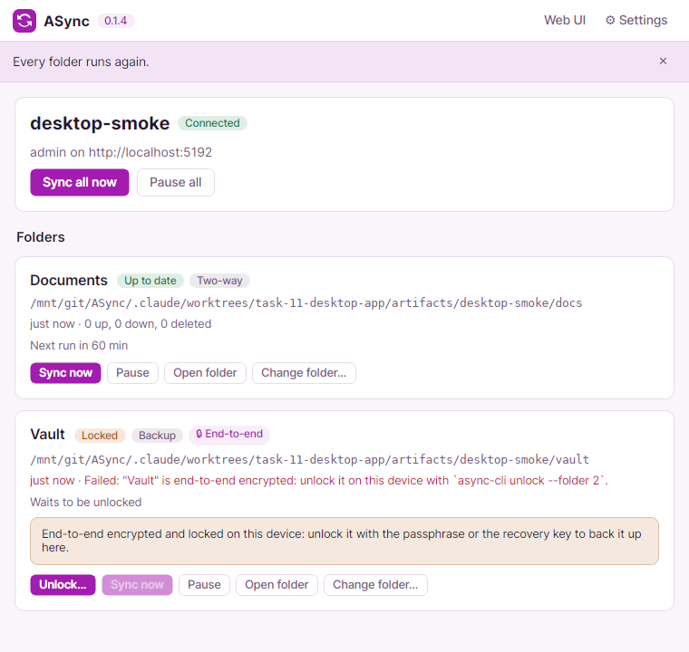
  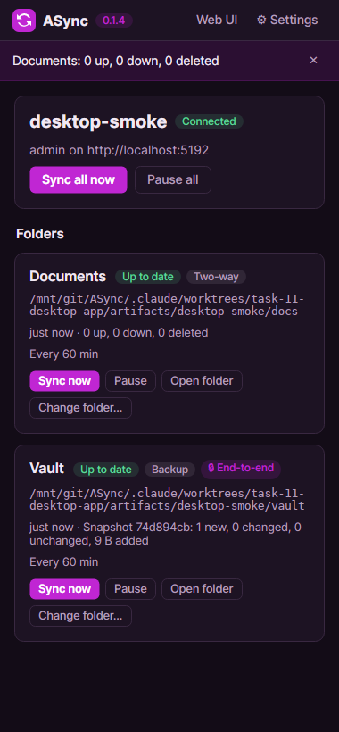
</p>

- **First start:** without an agent the app offers *Install and start the agent* (a systemd user unit on Linux, a
  LaunchAgent on macOS, a logon task on Windows; a stopped one is started by itself). Then enter the server's address
  and either the code from *Devices → Add device* (pasting the `async://pair…` link of its QR code fills in both), or
  choose *Approve in the browser*: the app shows a code and opens the server's approval page.
- **Folders:** create one with *New folder…*, add the computer to one of yours with *Add to a folder…* (see
  [Adding folders from the apps](#adding-folders-from-the-apps)), or attach folders to the device in the web UI: they
  appear in the app at once, with their mode, whether
  they are end-to-end encrypted, the local folder, what they are doing (with files and bytes while syncing), the last
  result, the next run, and whether the server considers the device overdue or failing for them. *Sync now*, *Pause*,
  *Open folder* and *Change folder…* (a folder picker) per folder; *Sync all now* and *Pause all* for everything.
- **End-to-end folders** set up on another device show *Unlock…*: enter the passphrase or the recovery key. It goes to
  the agent only, which keeps the unlocked key so backups run unattended; it is never shown or logged.
- **Tray:** the icon shows up to date, syncing or a problem (the tooltip says which); its menu has *Sync now*, *Pause
  all*, *Open ASync*, *Open the web UI* and *Quit ASync*. Closing the window keeps the app in the tray; *Quit* ends the
  app, not the agent. On Linux the tray needs a panel that shows StatusNotifier icons (KDE, most panels; GNOME with the
  AppIndicator extension); without one, closing the window ends the app.
- **Notifications** when a folder starts failing, when it works again, and when a sync kept both versions of a file
  (a conflict). They can be turned off in *Settings*.
- **Settings:** start at login (into the tray), light/dark/system theme, the web UI, the app's and the agent's
  versions, and *Sign out of this device* (it stops syncing and forgets the identity here; your files stay; remove the
  device in the web UI too).

- **Updates:** the app looks for a new version after it starts and once a day (*Settings → Updates*: turn it off, or
  *Check now*). A new version shows at the top of the window and in the tray menu; nothing is installed until you press
  *Install and restart*. The app then downloads it, waits for a running sync to finish (or not, if you say so), stops
  the agent, installs the update and starts again, and the agent restarts on the new version too.

<p>
  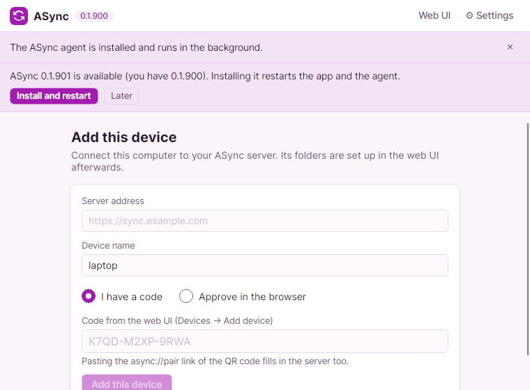
  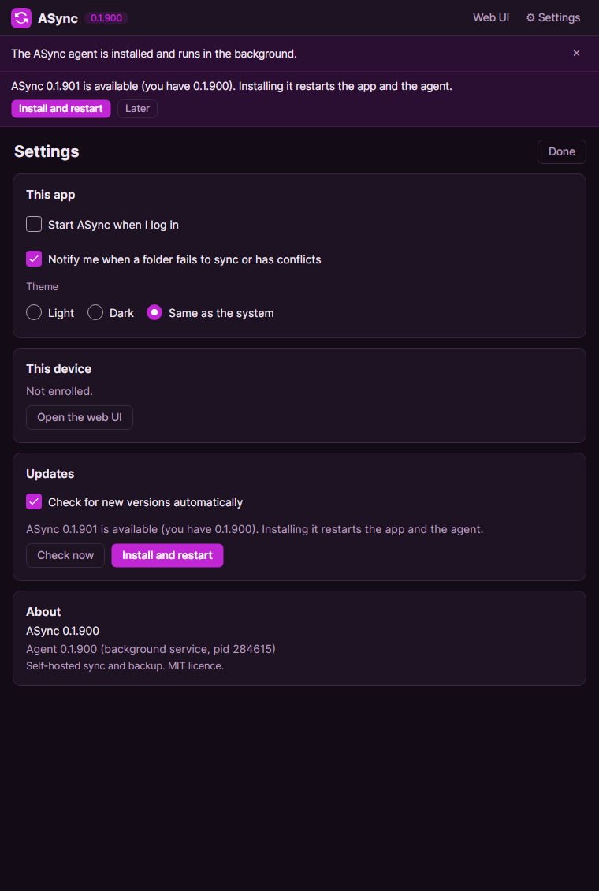
</p>

It uses the same config directory as `async-cli` (`~/.config/async`, `ASYNC_CONFIG_DIR` or `--config`), so an agent set
up with the CLI shows up in the app and the other way round. Only one app runs per config directory; starting it again
brings its window up.

### Installing the desktop app

Download it from the [releases](https://github.com/jncchds/ASync/releases) page. The builds are **not code-signed yet**,
so Windows and macOS warn about them the first time; the steps below get past that.

| OS | Download | Updates |
|---|---|---|
| Windows 10/11 (x64, ARM64) | `ASync.Desktop-win-x64-Setup.exe` (or `-win-arm64-`): installs for your user, no administrator needed, adds ASync to the Start menu and the desktop | by the app |
| macOS 12+ (Apple silicon) | `ASync-<version>-osx-arm64.dmg`: drag ASync to Applications. Or `ASync.Desktop-osx-arm64-Setup.pkg` | by the app |
| Linux (x64, ARM64) | `ASync.Desktop-linux-x64.AppImage` (or `-arm64`): make it executable and run it, from where you want to keep it | by the app |
| Debian, Ubuntu | `async-desktop_<version>_amd64.deb` (or `arm64`): `sudo apt install ./async-desktop_*.deb` | by `apt` |
| Fedora, openSUSE, RHEL | `async-desktop-<version>-1.x86_64.rpm` (or `aarch64`): `sudo dnf install ./async-desktop-*.rpm` | by `dnf`/`zypper` |

- **Windows (unsigned):** SmartScreen says "Windows protected your PC". Choose **More info → Run anyway**. The app is
  installed to `%LocalAppData%\ASync.Desktop`; the agent runs as the logon task "ASync Agent". Notifications show under
  "ASync".
- **macOS (unsigned):** macOS refuses to open it the first time ("cannot verify that it is free of malware" or "is
  damaged"). Right-click (Control-click) ASync in Applications → **Open** → **Open**; on macOS 15 and later, if there is
  no Open button, go to **System Settings → Privacy & Security** and press **Open Anyway**. Or, in Terminal:
  `xattr -dr com.apple.quarantine /Applications/ASync.app`. ASync lives in the menu bar (no Dock icon); the agent runs as
  the LaunchAgent `ua.pp.chds.async.agent`.
- **AppImage:** `chmod +x ASync.Desktop-linux-x64.AppImage` and run it. It needs FUSE (`libfuse2` or `fuse3`, present on
  most desktops). The agent service it installs runs the AppImage file itself, so keep it where it is (or install the
  agent again from the app after moving it); updates replace the file in place.
- **.deb / .rpm:** installs `/opt/async-desktop` (with `async-desktop` in `/usr/bin`), a menu entry and the systemd user
  unit `async-agent.service`, which nobody runs until they press *Install and start the agent* in the app (or
  `systemctl --user enable --now async-agent`). The app does not update itself; the package manager does, and an
  upgrade restarts running agents on the new version.

**Uninstalling.** The agent service goes with the app; your device's identity, keys and settings (the config directory:
`~/.config/async` on Linux and macOS, `%AppData%\async` on Windows) stay, so a reinstall picks up where you
left off. Delete that folder (or run the uninstall command below with `--remove-data`) to remove them too, and remove
the device in the web UI.
- **Windows:** *Settings → Apps → ASync → Uninstall*. It stops and removes the agent's logon task and start at login.
- **macOS:** run `/Applications/ASync.app/Contents/MacOS/async-desktop uninstall` (removes the LaunchAgents of the agent
  and of start at login; add `--remove-data` for the config too), then move ASync to the Trash.
- **AppImage:** `./ASync.Desktop-linux-x64.AppImage uninstall [--remove-data]`, then delete the file.
- **.deb / .rpm:** `sudo apt remove async-desktop` / `sudo dnf remove async-desktop` stops and disables the agent of every
  user that runs it and removes their start-at-login entries.

`uninstall` leaves an agent service that runs another program (one set up with `async-cli service install`) alone.

To build it yourself: `dotnet publish src/ASync.App.Desktop -c Release -o ~/async-desktop` (.NET 10 SDK), then run
`~/async-desktop/async-desktop`; such a copy does not update itself. `scripts/package.sh <rid>` builds the installers
(see "Development").

## The Android app

<p>
  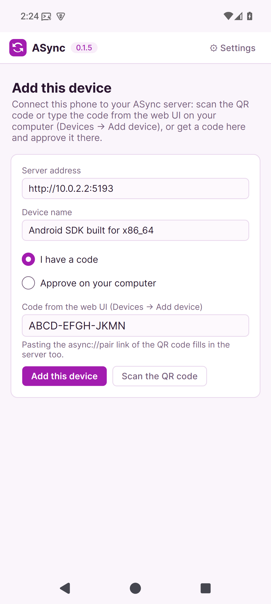
  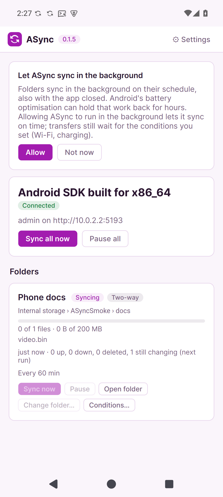
  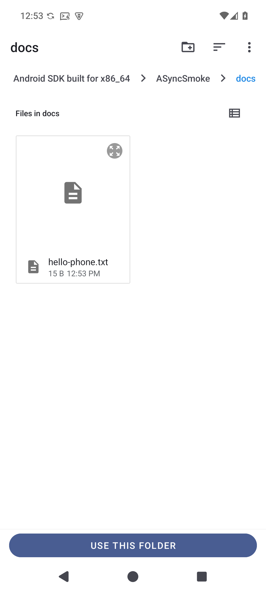
  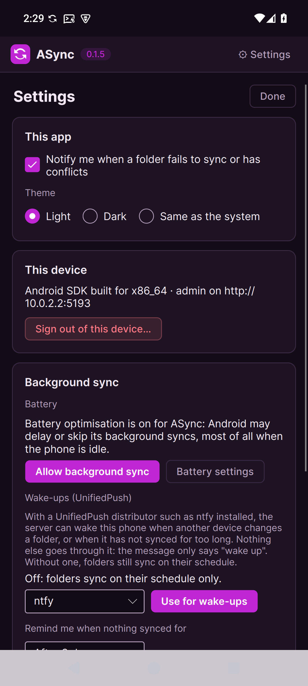
</p>

The same pages as the desktop app, on Android 8 and later. **The phone never needs its own browser:** the server is set
up in the web UI on a computer (folders, storage, people), and everything done *on the phone* is in the app; the app has
no web UI buttons there.
- **Adding the phone:** scan the QR code of *Devices → Add device* on your computer (the camera; no Google services
  needed), tap or paste its `async://pair` link, type the server address and the code, or *Approve on your computer*: the
  phone shows a short code to enter in the web UI there (*Devices → Approve*). The phone's key is made in
  the Android Keystore (in its secure hardware where it has some) and never leaves it; what the app stores about the
  device is encrypted with another Keystore key.
- **Folders:** create one on the phone with *New folder…*, or add the phone to one of yours with *Add to a folder…* (see
  [Adding folders from the apps](#adding-folders-from-the-apps)). Or attach a folder to the phone in the web UI on your
  computer (any local path will do: the phone asks), then *Choose folder…* on the phone picks where it lives: anywhere on the phone with *All files access* (see
  [Folders anywhere on the phone](#folders-anywhere-on-the-phone)), or with Android's own folder picker (internal
  storage, an SD card, a USB drive, or another app's storage, but not their top level or Download). Two-way, Mirror and Backup folders work there; *Sync now*, pause and resume, live progress,
  unlocking end-to-end folders, and the settings (theme, sign out) as on the desktop. A **new end-to-end folder** is set up
  on the phone itself: *Set up encryption…* asks for its passphrase (twice) and shows the recovery key once; other
  devices then unlock it with the same passphrase (`async-cli unlock`, or *Unlock…* in the apps). The Back button closes dialogs and
  settings.
- **In the Files app:** your folders and backups show in Android's Files app and every file picker, fetched when opened:
  see [ASync in the Files app](#async-in-the-files-app).
- **In the background (M4-2):** folders keep syncing and backing up with the app closed, on their interval (Android runs
  background work at most every 15 minutes), only on Wi-Fi or while charging if you say so, and the server can wake the
  phone when another device changed something: see [Background sync on Android](#background-sync-on-android).
- **Not yet:** photos, contacts and calendars come later. Files changed on the phone are noticed on the next run, not at
  once. Folders chosen with Android's folder picker cannot keep file times: files downloaded to the phone carry the time they were
  downloaded (with All files access they keep their times), and names a storage cannot hold (`:`, `?`… on SD cards) fail that file with a message. A file written in
  the last 10 seconds waits for the next run (Android touches a new file's time once more a few seconds after it was
  written, which would otherwise upload it twice).

### Folders anywhere on the phone

<p>
  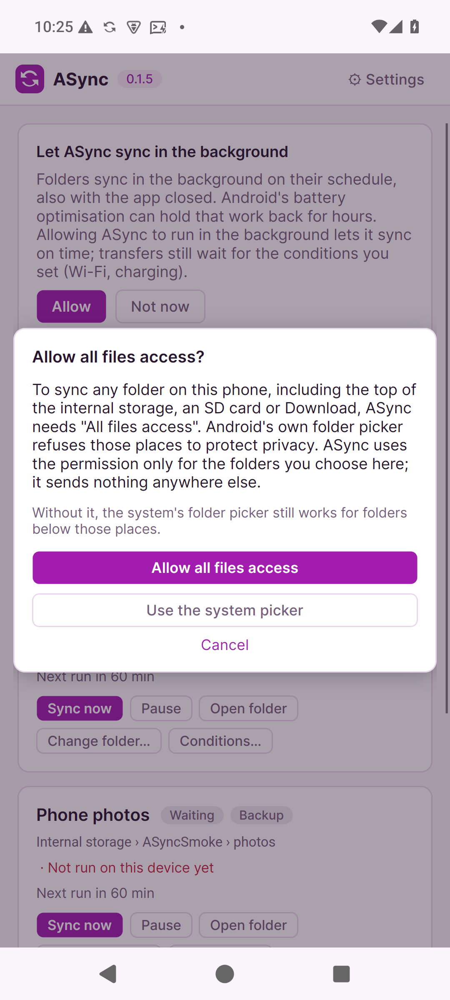
  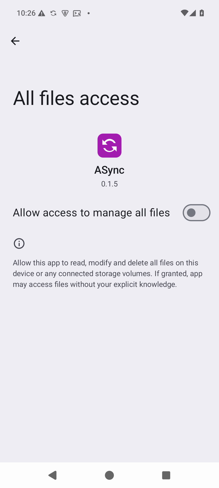
  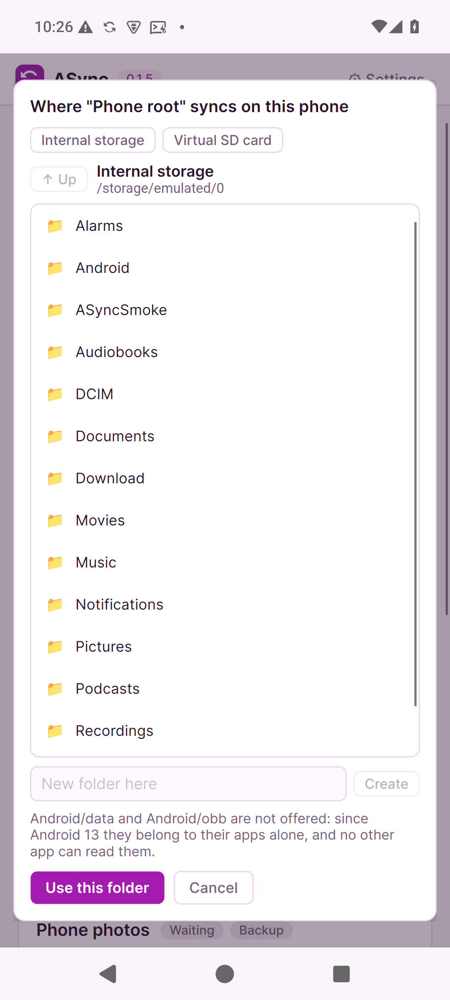
  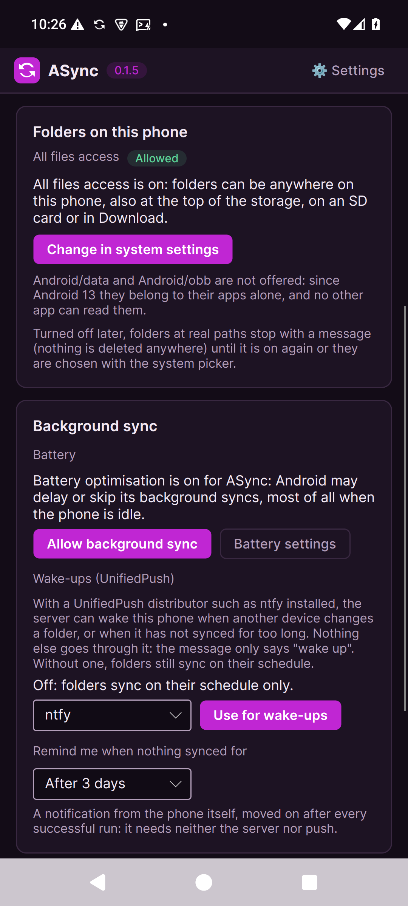
</p>

Android's own folder picker refuses the top level of the internal storage, of an SD card or USB drive, and Download
("to protect your privacy"). To sync those, ASync can use **All files access**, as file managers and sync apps such as
FolderSync, Solid Explorer and Syncthing-fork do (the APK is installed from our releases, not Google Play, whose rules
would not allow it):

- **Granting it:** *Choose folder…* (or *Change folder…*) explains why in one screen; *Allow all files access* opens
  Android's page for ASync (*Settings → Apps → Special app access → All files access → ASync* on most phones): turn on
  *Allow access to manage all files* and go back. *Use the system picker* keeps Android's picker instead. On Android 8–10
  the app asks for the storage permission instead. *Settings → Folders on this phone* shows whether it is on and opens
  the same page to change it.
- **ASync's folder picker:** the internal storage, each SD card and USB drive by name, and every folder on them: choose
  the top of a volume, Download, or anything below; *New folder here* makes one. The server and the web UI show the
  folder as its real path, e.g. `/storage/emulated/0/DCIM`.
- **Out of reach:** Android/data and Android/obb are not offered, and are left out of a folder at the top of a volume:
  since Android 13 they belong to their apps alone, All files access or not.
- **Folders chosen before:** once the access is on, a folder chosen with Android's picker shows *Use the real path
  /storage/emulated/0/…*. Switching keeps its sync state: nothing is uploaded or downloaded again, no conflicts.
- **Turned off later:** folders at real paths stop with "All files access was turned off for ASync", also in the
  background, and nothing is deleted on the phone or the server. Turn it on again, or choose the folder with the system
  picker. Android may restart the app when you change the switch; that is expected.
- Such folders are not watched for changes: they run on their schedule, on *Sync now* and when the app is opened.

### Background sync on Android

<p>
  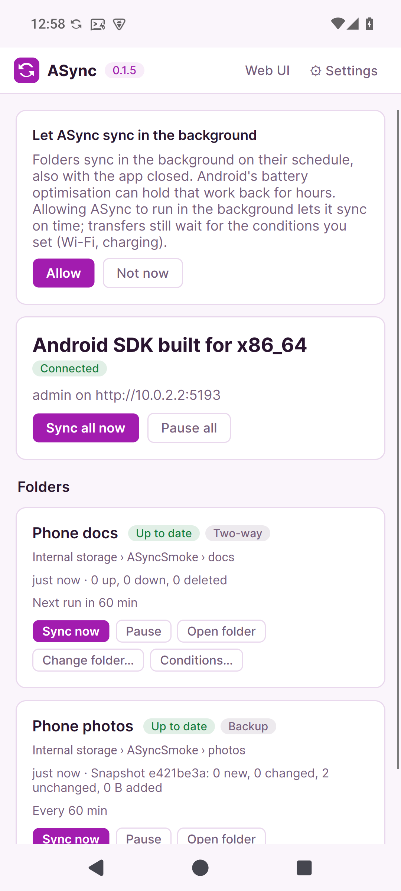
  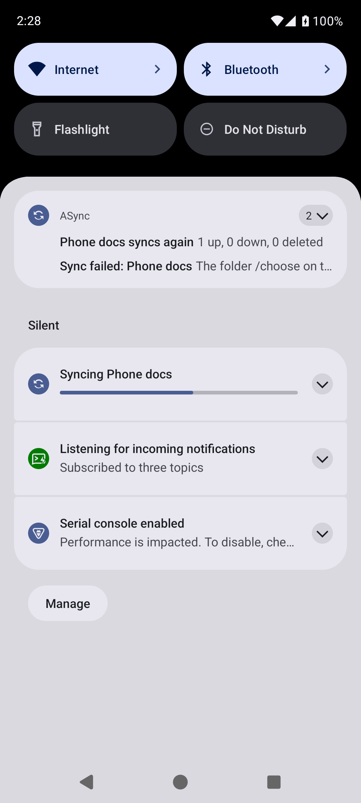
  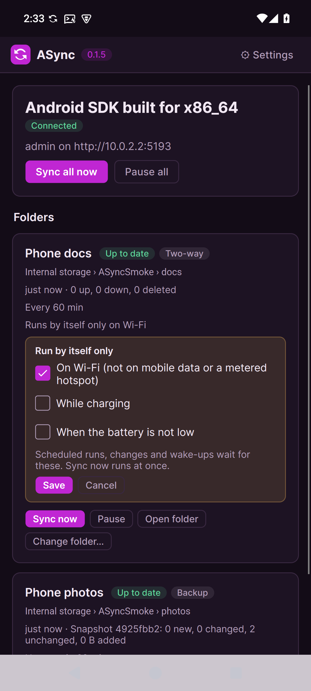
  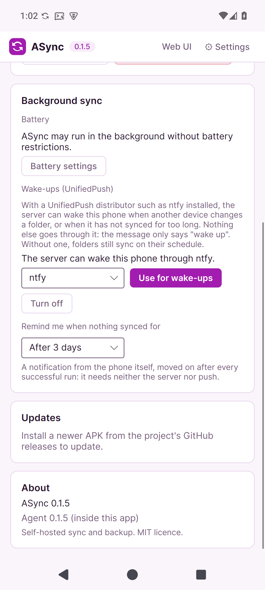
</p>

- **On a schedule:** each folder runs at its interval (at least every 15 minutes, Android's shortest), also after a
  restart of the phone and with the app swiped away. Opening the app runs every folder at once; *Sync now* runs one at
  once whatever its conditions.
- **Conditions:** *Conditions…* on a folder (or the folder's device form in the web UI) chooses *On Wi-Fi* (not on
  mobile data or a metered hotspot), *While charging* and *When the battery is not low*. Scheduled runs and wake-ups wait
  for them; the folder shows why it waits ("Waiting for Wi-Fi"). Computers honour the charging and battery rules, and the
  Wi-Fi rule where the system says a network is metered (Linux with NetworkManager); elsewhere it is ignored.
- **Long transfers:** while a folder runs, a notification shows its progress with a *Cancel* button, and Android keeps the
  network for it. A transfer that is cut off (Cancel, the phone going to sleep, Android 15's limit of six hours of such
  transfers a day) continues where it stopped at the next run.
- **Battery:** the first time, the app explains and offers *Allow*: Android then asks whether ASync may run in the
  background without battery optimisation. Without it, Android may hold background runs back for hours when the phone
  is idle. *Settings → Background sync* shows the state, opens Android's battery list, and says what else your phone's
  maker needs: Xiaomi, Huawei/Honor, Samsung, OnePlus/OPPO/realme, vivo and others stop background apps beyond Android's
  rules (see [dontkillmyapp.com](https://dontkillmyapp.com)).
- **Reminder:** when a folder has not synced for 3 days (*Settings → Remind me when nothing synced for*: 1–14 days or
  never), the phone itself shows a notification. It is moved on after every successful run and needs neither the
  server nor push. The server's own overdue alerts (see [Alerts](#alerts)) work as before.
- **Wake-ups (UnifiedPush):** install a UnifiedPush distributor, for example [ntfy](https://ntfy.sh) (F-Droid or its
  GitHub releases; no Google services needed), then in ASync *Settings → Background sync → Wake-ups*, choose it and *Use
  for wake-ups*. The distributor gives the phone an address that the server posts a tiny "wake" to (it carries no file
  names or data) when another device changed a two-way or download folder while the phone was not connected, and while
  the phone is overdue. The Devices page in the web UI shows *UnifiedPush* and the distributor's server (the address
  itself is secret: it can wake the phone) with *Send wake-up* to try it. Without a distributor everything still syncs
  on its schedule.
  - **With your own ntfy server:** run ntfy (e.g. `docker run -p 8090:80 binwiederhier/ntfy serve`, behind https for
    phones outside your network), and in the ntfy app *Settings → Default server* set its address *before* choosing it
    in ASync. The ASync server must be able to reach that address (it posts there); with the public ntfy.sh it can.
  - Google's push (FCM) and a relay for Play-store builds are not built yet; the app needs neither.

### ASync in the Files app

<p>
  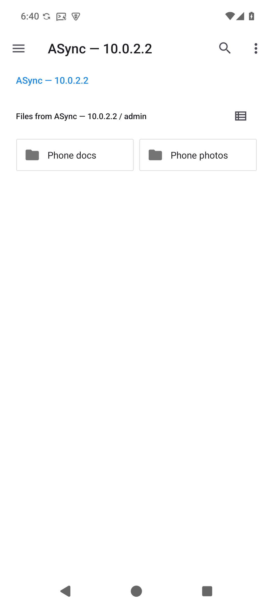
  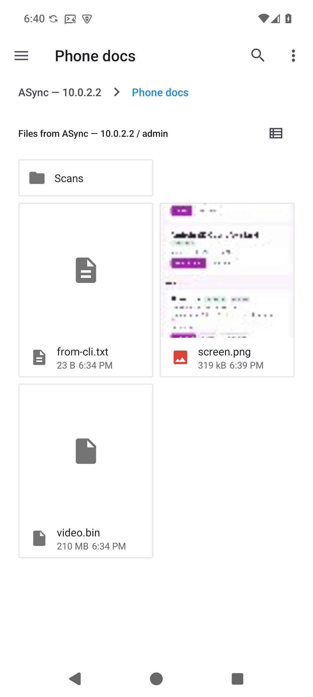
  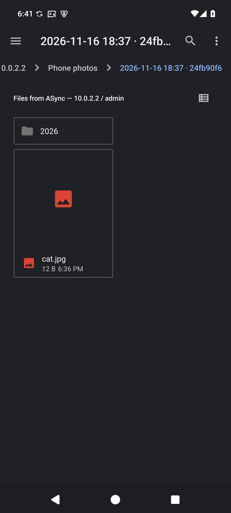
  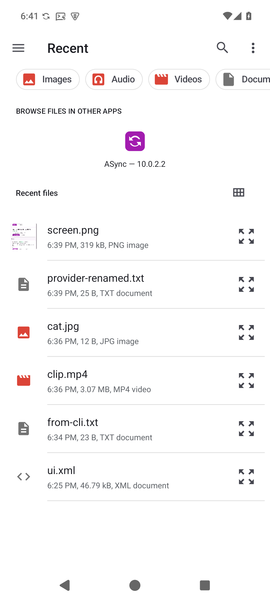
</p>

Your ASync folders also show in Android's **Files** app and in every app's file picker ("attach a file", "open", "save
to"), without syncing them to the phone first: files are fetched when you open them.
- **Finding it:** open *Files*, then the menu (☰): **ASync — <your server>** is in the list next to *Downloads* and
  *Internal storage*. In another app, *attach* or *open* a file, then the same menu. It is there once the phone is
  enrolled; if the phone was removed from your account, it says so.
- **Two-way folders:** browse, open, and also save, create, rename, move, copy and delete. Changes go to the server
  exactly as a sync's would: an overwritten file keeps its old content as a version and a deleted one goes to the
  folder's trash (both restorable in the web UI under *Files*), and your other devices pick the change up. If the folder
  is also synced to a folder on this phone, that copy updates by itself right after. A new, empty directory stays on the
  phone until you put a file in it.
- **Mirror folders** are read-only here (the device that uploads them decides what is in them); copy a file out to
  change it.
- **Backup folders:** one directory per snapshot, newest first (named by date, time and short id), with the files as they
  were. Read-only: open a file, or copy it into a two-way folder or onto the phone to restore it. End-to-end encrypted
  backups open once they are unlocked in the app (*Unlock…*); until then the folder says "Unlock it in the ASync app".
- **Large files** stream: anything over 128 MB is read in pieces as the app needs them (videos can be skipped through)
  and never stored on the phone. Smaller files are kept in a 512 MB cache, so opening them again is instant. Large
  transfers show the same notification (with *Cancel*) as a sync. *Only on Wi-Fi* and the other conditions apply to
  background syncs only, not to a file you open yourself.
- **Search** (in the Files app's search box) finds file names in your two-way and mirror folders; *Recent* lists their
  most recently changed files. Backups are not searched. Images get thumbnails.
- **Offline:** the ASync entry needs the server: without a connection the folders cannot be listed, and the Files app
  shows "Cannot reach the ASync server". Files you sync to a folder on the phone are of course still there, in that
  folder. A file saved while the server cannot be reached is not stored: the phone shows a notification saying so.

### Installing the Android app

The app is not in Google Play. Download `ASync-<version>-android.apk` from the
[releases](https://github.com/jncchds/ASync/releases) page on the phone and open it; Android asks once to allow
installing apps from your browser (or file manager): allow it, then *Install*. Play Protect may say it does not know the
app: *More details → Install anyway*. One APK covers Android 8.0 and later on phones (64-bit and 32-bit ARM: budget phones and Android Go editions run Android in
32-bit mode) and emulators/Chromebooks (x86_64). If Android says the app is *not compatible*, it is an older APK without
32-bit ARM (before v0.1.6) or a phone older than Android 8.0.

- **Updates:** install the newer APK over the old one; your enrollment and folders stay. Android only accepts an update
  signed like the installed app: the releases are signed with the project's key once it is set up; until then builds
  are signed with a throw-away debug key, and moving between two differently signed builds needs an uninstall first
  (then enroll the phone again and remove the old device in the web UI).
- **Uninstalling** removes the app's keys and settings with it (Android deletes them); remove the device in the web UI
  too. The synced files stay where they are.
- **http servers** (no TLS, e.g. on your LAN) work, as on the desktop; prefer https.

To build it: `dotnet workload install android`, an Android SDK (`ANDROID_HOME`) and JDK 17, then
`scripts/package-android.sh` (APK in `artifacts/packages/android`).

## The iOS app

<p>
  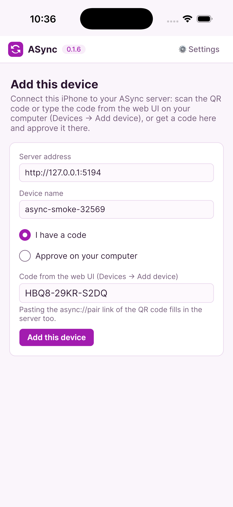
  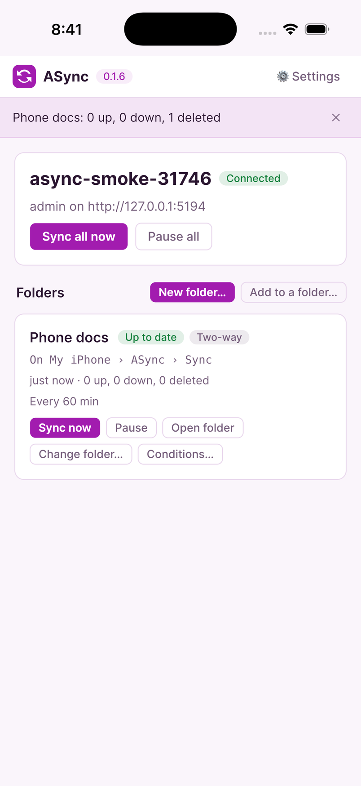
  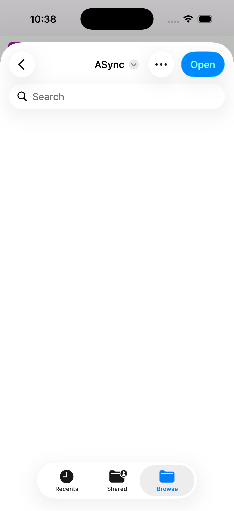
  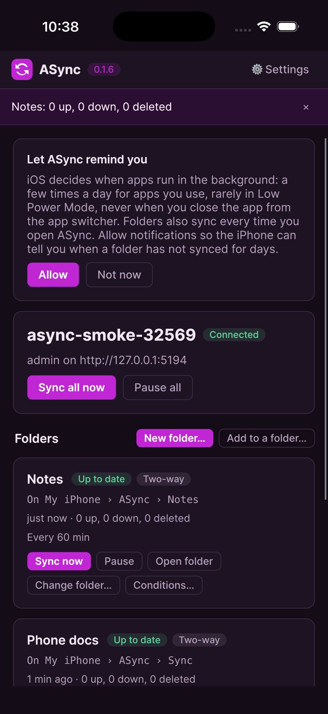
</p>

**Early (v0.1.6).** The same pages as the Android app, on iOS 15 and later, syncing also in the background as far as iOS allows
(below), and backing up the photo library, contacts and calendars. Like on Android, the phone never needs its browser: the server is set up in the web UI on a computer.
- **Adding the iPhone:** scan the QR code of *Devices → Add device* with the app's *Scan the QR code* (or with the Camera
  app: it opens ASync), tap or paste its `async://pair` link, type the server address and the code, or *Approve on your
  computer* (a short code to enter in the web UI there). The device's key is made in the iPhone's **Secure Enclave** and
  never leaves it; what the app stores about the device is encrypted with a key in the Keychain (this device only, readable
  after the first unlock). Signing out deletes the key.
- **Folders:** the app's own folder, *On My iPhone › ASync* in the Files app (put files there from any app), or any folder you
  pick with *Choose folder…* (the system's picker: On My iPhone, iCloud Drive, other apps' storage); ASync keeps the
  permission to it across restarts. If a picked folder is deleted, moved off the device or ASync is reinstalled, the folder
  says *Choose the folder again* and nothing is synced or deleted. *New folder…* and *Add to a folder…* work as on Android,
  and so do Two-way, Mirror and Backup folders, *Sync now*, pause, end-to-end setup and unlocking. From the web UI on a
  computer, *Browse…* lists the app's own folder (picked folders are chosen on the iPhone).
- **Photos and videos** (*New folder… → Photos & videos*): see [Backing up photos and videos](#backing-up-photos-and-videos), with
  Live Photos, edits, RAW and iCloud originals.
- **Contacts and calendars** (*New folder… → Contacts / Calendars*): see [Backing up contacts and calendars](#backing-up-contacts-and-calendars),
  with what iOS keeps from apps (notes, writing guests).
- **In the Files app:** your folders and backups as the location **ASync — <your server>**, files fetched when opened (iOS 16
  and later, a signed build): see [ASync in the iOS Files app](#async-in-the-ios-files-app).
- **Picked folders in iCloud Drive or another app's storage** work also when their files are not downloaded to the iPhone: ASync
  asks the provider for them (and waits while they download) instead of failing.
- **Not yet:** tried on the iOS simulator only (in CI), not on an iPhone yet; the camera scanner and real background slots can
  only be tried on one.

### ASync in the iOS Files app

<p>
  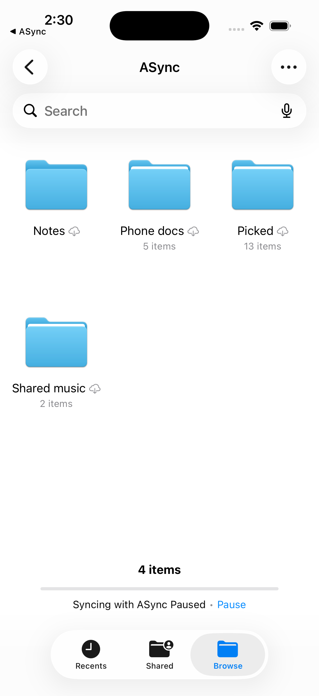
  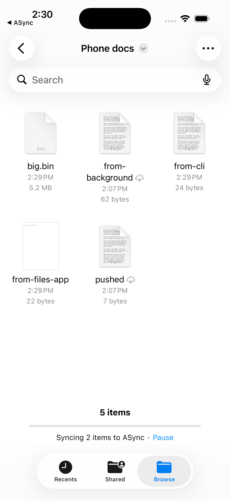
  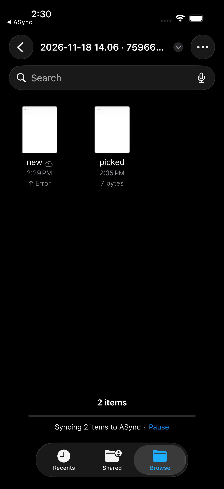
  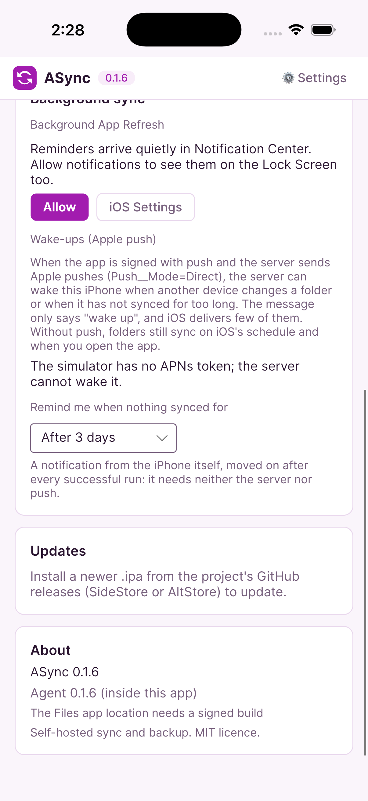
</p>

As on Android, your ASync folders show in the iPhone's **Files** app and in every app's file picker ("attach", "open", "save to",
"Save to Files"), without syncing them to the iPhone first: files are fetched when you open them.
- **Finding it:** in *Files*, *Browse* → **ASync — <your server>** under *Locations* (if it is not listed: *⋯ → Edit* and turn it
  on). It is there once the iPhone is enrolled and goes away when you sign out; if the iPhone was removed from your account, it
  says so ("Open ASync to enroll it again").
- **Two-way folders:** browse, open, save, create, rename, move and delete. Changes go to the server exactly as a sync's would:
  an overwritten file keeps its old content as a version, a deleted one goes to the folder's trash (both restorable in the web UI
  under *Files*), your other devices pick the change up, and if the folder is also synced to a folder on this iPhone, that copy
  catches up the next time ASync runs.
- **Mirror folders** are read-only here (the device that uploads them decides what is in them), and so are **backups**: one folder
  per snapshot, newest first, named by date, time and short id. Copy a file out to change or restore it. End-to-end encrypted
  backups open once they are unlocked in the app.
- **Large files** are streamed to the iPhone when opened, never held whole in memory; iOS keeps the files you opened and removes
  them again when it needs the space (or *Remove Download* in the Files app). Opening a file needs the server.
- **Changes from other devices** show by themselves while ASync can be woken (its connection while open, a silent push in a build
  signed for push) and otherwise the next time ASync runs or the Files app asks again (opening the folder).
- **What it needs:** a build signed with a paid Apple developer account (the App Store, TestFlight or your own signing), with
  the app group `group.ua.pp.chds.async` for the app and its extension. The sideloaded `ASync-<version>-unsigned.ipa` cannot
  have it (SideStore and AltStore re-sign with a free Apple ID, which gives an app no app group of this name): everything else
  works as before, and *Settings* says "The Files app location needs a signed build".

### Background sync on iOS

<p>
  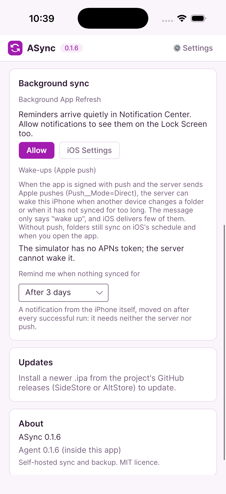
  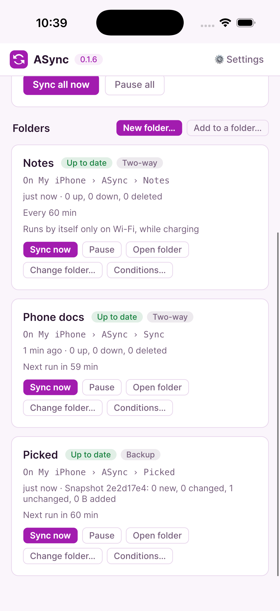
  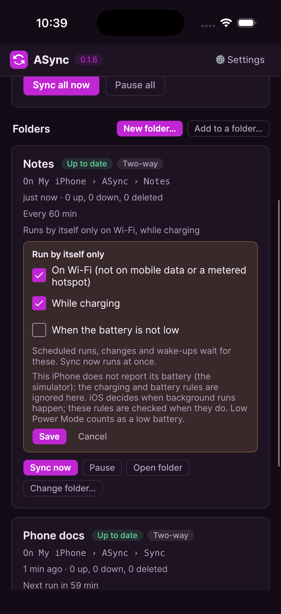
  
</p>

iOS, not the app, decides when an app may run in the background. ASync asks for what iOS offers and makes the most of it:
- **Opening the app syncs every folder**, and while it stays open, folders run when their interval is due. This is the one way
  that always works: when a folder matters, open ASync.
- **Background slots:** a short one (about 30 seconds: enough for small changes and downloads) and a longer one (minutes,
  usually at night while the iPhone charges). ASync asks for them at the folders' shortest interval (at least 15 minutes), but
  iOS chooses: a few times a day for apps you use, less for apps you rarely open, **none in Low Power Mode**, none when
  *Settings › General › Background App Refresh* is off for ASync, and **none after you close ASync from the app switcher**
  (until you open it again). A run that does not finish in its slot stops cleanly; large files continue where they stopped.
- **Leaving the app during a sync:** the run carries on for the time iOS grants (usually half a minute, sometimes more),
  then stops cleanly and continues at the next run.
- **Conditions** (*Conditions…* on a folder, or the web UI): *Wi-Fi only* waits on cellular, on a phone's hotspot and in Low
  Data Mode; *while charging* waits off the charger (such a folder then asks iOS for a slot on external power); *battery not
  low* waits at 15 % or less and in Low Power Mode. They hold back only the automatic runs; *Sync now* always runs.
- **Reminder:** *Settings → Background sync → Remind me when nothing synced for* (3 days by default, *Never* to turn it off):
  the iPhone itself tells you when a folder has had no successful run for that long, even when nothing else works. The
  reminders arrive quietly in Notification Center until you tap *Allow* on the dashboard (once) for alerts on the Lock Screen;
  if you turn notifications off for ASync, there are no reminders.
- **Back up now:** press and hold the ASync icon for *Back up now*, or open `async://sync` (for example from a Shortcuts
  automation: *Open URLs* when you arrive home or connect the charger). It opens ASync and runs every folder at once.
- **Wake-ups from the server** need an app signed with push and a server with `Push__Mode=Direct` and an APNs key (see the
  settings table). The sideloaded .ipa is not signed for push: it does not register and does not need to: its folders still
  run on iOS's slots, when opened, and you still get the reminder and the server's overdue alerts. Settings shows which
  applies.

### Installing the iOS app

There is no App Store or TestFlight build yet (that needs a paid Apple developer account). Each release has
`ASync-<version>-unsigned.ipa`, which you **sideload** with [SideStore](https://sidestore.io) or
[AltStore](https://altstore.io): they sign it with your own Apple ID on your device.
1. Install SideStore (or AltStore) on the iPhone, following its guide (once, with a computer).
2. Download `ASync-<version>-unsigned.ipa` from the [releases](https://github.com/jncchds/ASync/releases) on the iPhone and open
   it with SideStore (*Share → SideStore*, or *+* in its *My Apps*).
3. Open ASync and add the iPhone (above).
- With a free Apple ID the signature lasts **7 days**: SideStore refreshes it in the background (AltStore needs its AltServer on
  your computer, on the same Wi-Fi). An app whose signature ran out does not open until it is refreshed; your enrollment and
  folders stay.
- **Updates:** install the newer .ipa the same way, over the old one; enrollment and folders stay.
- **Uninstalling** removes the app's data, its key and its Keychain items; remove the device in the web UI too. Files in
  *On My iPhone › ASync* go with the app (move them out first); picked folders stay where they are.
- **http servers** (no TLS, e.g. on your LAN) work, as on the other apps; iOS asks once whether ASync may use the local
  network. Prefer https.

To build it you need a Mac with Xcode and `dotnet workload install ios`: `scripts/package-ios.sh` (the unsigned .ipa) or
`scripts/package-ios.sh --simulator`. On Linux, `scripts/check-ios.sh` compiles the app's code without building it.

## Run an agent

`async-cli` is the headless agent for servers, NAS boxes and other machines without a screen. It syncs and
backs up the folders you assign to it in the web UI.

### In Docker

Make a code in *Devices → Add device* (a reusable one works for many agents), then:

```bash
docker run -d --name async-agent --restart unless-stopped \
  -e ASYNC_SERVER=https://sync.example.com \
  -e ASYNC_ENROLL_CODE=K7QD-M2XP-9RWA \
  -e ASYNC_DEVICE_NAME=nas \
  -v async-agent-config:/config \
  -v /srv/photos:/data/photos \
  <dockerhub-user>/async-cli:latest
```

On first start the agent enrolls itself; after that the code is no longer needed. Then attach folders to the
device in the web UI, with local paths as the container sees them (`/data/photos`). The image is built from
[Dockerfile.cli](Dockerfile.cli) for amd64 and arm64; there is a commented-out `async-cli` service in
[docker-compose.yml](docker-compose.yml) as well.

- **Keep the `/config` volume.** It holds the device's key, unlocked end-to-end keys and the sync state.
  Without it the agent has to be enrolled again.
- The agent runs as uid 1654. Mounted folders must be readable by it, and writable for TwoWay folders and
  Mirror folders that download. Or run it as your own user with `--user $(id -u):$(id -g)`.

### Without Docker

Each [release](https://github.com/jncchds/ASync/releases) has `async-cli` as one self-contained file (no .NET needed) for
Linux, Windows and macOS: `async-cli-<version>-<rid>.tar.gz` (`.zip` on Windows; rid `linux-x64`, `linux-arm64`,
`win-x64`, `win-arm64`, `osx-arm64`), and as `async-cli_<version>_amd64.deb` / `async-cli-<version>-1.x86_64.rpm` (and
arm64) with `/usr/bin/async-cli`. The packages are updated by the package manager, which also restarts a running
`async-cli` service on the new version and, on removal, removes the services that run it. The archive is updated by
hand: replace the file and run `async-cli service install` again (it restarts the service on the new version); there
is no `async-cli update`. Or build it with the .NET 10 SDK (`dotnet publish src/ASync.Cli -c Release -o ~/async-cli`).
Its identity lives in `~/.config/async`, or in `ASYNC_CONFIG_DIR`, or in `--config <dir>`.

```bash
async-cli enroll --server https://sync.example.com --code K7QD-M2XP-9RWA   # or without --code: approve a link
async-cli run                                                                # keep syncing (Ctrl+C stops)
```

### As a background service (Linux, Windows, macOS)

`async-cli service install` runs the agent in the background for your user, starts it at logon and restarts it
when it fails. Enroll first (or afterwards: a service without an identity waits for `async-cli enroll`).

```bash
async-cli enroll --server https://sync.example.com --code K7QD-M2XP-9RWA
async-cli service install     # writes the service for this OS, enables and starts it
async-cli service status      # is it installed and running, and what is each folder doing
async-cli service uninstall   # stops and removes it (the identity and your folders stay)
```

| OS | What `service install` sets up | Logs |
|---|---|---|
| **Linux** | the systemd user unit `~/.config/systemd/user/async-agent.service` (`Type=notify`) | `journalctl --user -u async-agent -f` |
| **macOS** | the LaunchAgent `~/Library/LaunchAgents/ua.pp.chds.async.agent.plist` | `~/Library/Logs/ASync/agent.log` (rolled over at 10 MB, 5 kept) |
| **Windows** | the Task Scheduler task "ASync Agent", run at your logon without a window | `%LOCALAPPDATA%\ASync\logs\agent.log` |

- **Linux:** a user unit runs while you are logged in. For a server or a NAS, keep it running without a
  login and start it at boot with `loginctl enable-linger $USER`, or install a system unit as root:
  `sudo async-cli service install --system --run-as <user>` (`/etc/systemd/system/async-agent.service`,
  running as that user, with `--config` pointing at their config directory).
- **Windows:** `--system` (as administrator) installs the Windows Service `ASyncAgent` instead, running as
  LocalSystem and logging to the Event Log (source "ASync Agent"). Its folders must then be readable by
  LocalSystem, and its identity is the machine's, not yours: the per-user task is the right choice on a desktop.
- **macOS:** `--system` (with sudo) installs a LaunchDaemon in `/Library/LaunchDaemons` running as `--run-as`.
- The log level is Information; `--verbose` at install time, or `ASYNC_LOG_LEVEL=Debug` in the service's
  environment, gives more. `--log-file <path>` adds a rolling log file anywhere.
- The service runs the same program you installed it from, with the same `--config`. After an update, run
  `service install` again; it restarts the service on the new version.

**While the service runs, the CLI talks to it.** `status`, `sync`, `pause`, `resume`, `set-path` and
`unlock` are sent to the running agent over a local control channel instead of being done by the command
itself, so a folder is never synced by two programs at once and the agent reacts at once (an unlock starts
the backup it was waiting for). `status` then also shows what each folder is doing right now (syncing, with
files and bytes, or backing up), its last result and its next run. A second `async-cli run` is refused, and so
is `forget`, until the service is stopped. Without a running agent the commands work as before.

**Where the device's key is kept:** in `~/.config/async/identity.json`, readable only by you (Linux, and in
Docker); encrypted with Windows DPAPI for your Windows account (Windows); in your login Keychain (macOS, item
`ua.pp.chds.async`), the file then only names the item. The same goes for unlocked end-to-end folder keys.
Identities made by earlier versions keep working and are moved to the new form the first time they are read.
`ASYNC_SECRET_STORE=file` keeps everything in the 0600 file on any OS (e.g. a Mac without a login Keychain).

### Commands

| Command | What it does |
|---|---|
| `enroll` | Adds this machine to your account: with `--code`, or by showing a link and code to approve in the web UI. |
| `status`, `folders` | This device, and the folders assigned to it. With a running agent, `status` also shows what each folder is doing. |
| `sync [--folder N] [--progress]` | Syncs (or backs up) every folder, or one, once. `--progress` prints a line for every part of a large upload the server has stored. An interrupted upload or download continues on the next sync. |
| `run` | Keeps syncing: on schedule, when files change, and as soon as another device changes a folder. The default in Docker. Refused while another agent (the service) runs for the same config directory. |
| `service install\|uninstall\|status [--system]` | Runs the agent in the background as a service of this OS (see above). |
| `set-path`, `pause`, `resume` | Changes this device's settings for a folder. |
| `browsing [--on\|--off]` | Shows, allows or forbids [choosing this device's folders from the web](#choosing-a-devices-folder-from-the-web) (on by default). `run --no-browse` or `ASYNC_ALLOW_BROWSE=0` keeps it off for that agent. |
| `init-encryption --folder N` | Sets up an end-to-end encrypted Backup folder (on one device) and prints its recovery key. |
| `unlock --folder N` | Unlocks an end-to-end encrypted folder on another device, with the passphrase or the recovery key. |
| `snapshots`, `restore` | Lists a Backup folder's snapshots, and restores one (or `--path` a part of it) into `--target`. `--snapshot` takes the short id that `snapshots` and the web UI show (the id's last 8 digits), the start of the id, or `latest`. |
| `snapshots --repo <dir>`, `restore --repo <dir>` | The same **without a server**, straight from the storage: `--repo` is the folder's directory (a local disk, a mounted share or a copy). For S3, WebDAV, SFTP or SMB add `--storage settings.json` (the connection settings, see below) and give the directory on that storage as `--repo`. Opens with the recovery key, an end-to-end passphrase, or an exported folder key, from `--key-file`, `ASYNC_RECOVERY_KEY` or typed in. Needs no enrolment. |
| `prune [--folder N]` | Frees the space of dropped snapshots in a Backup folder (or in all of this device's) now, and says what was removed and how much was freed. |
| `check [--folder N] [--read-data <percent>]` | Verifies a Backup folder (or all of this device's): nothing missing, and with `--read-data` that this share of the stored data reads back correctly (100 = everything). Lists the problems and exits with code 1 when it finds any. |
| `forget` | Removes this device's identity from the machine. |

Passphrases are read from `ASYNC_PASSPHRASE`, from `--passphrase-file`, or typed in. A sync that would delete
more than half of a folder's files stops; run it with `--allow-mass-delete` if that is what you want. Removing
the device in the web UI cuts it off at once: a running agent stops with an explanation. `prune` and `check`
work on standard and end-to-end folders alike; their results appear on the *Folders* page. Both say "BUSY"
and exit with code 1 when a backup or another prune is using the folder: run them again later.

### Restoring without the server

You need the folder's directory on the storage (the web UI shows it with the recovery key: on shared storage it
is inside `users/<id>/`) and its recovery key. Nothing else: no server, no database, no enrolled device.

```bash
async-cli snapshots --repo /mnt/backup-disk/photos                 # asks for the recovery key
async-cli restore --repo /mnt/backup-disk/photos --target ~/photos --snapshot latest

# On remote storage: the connection settings as JSON (the same fields as in the web UI's storage form)
cat > s3.json <<'EOF'
{ "type": "S3", "endpoint": "https://s3.example.com", "region": "us-east-1", "bucket": "backups",
  "prefix": "async", "accessKeyId": "…", "secretAccessKey": "…", "forcePathStyle": true }
EOF
ASYNC_RECOVERY_KEY=ABCD-EFGH-… async-cli restore --storage s3.json --repo photos --target ~/photos
```

The `type` is `S3`, `WebDav` (`url`, `username`, `password`), `Sftp` (`host`, `port`, `username`, `password` or
`privateKey`, `path`, optionally `hostKeyFingerprint`) or `Smb` (`host`, `share`, `path`, `username`,
`password`). Without a `hostKeyFingerprint` an SFTP server's key is accepted as it is.

## Development

See [CLAUDE.md](CLAUDE.md) for commands and rules, and [AGENTS.md](AGENTS.md) for the architecture.
The tests include API-level checks of every endpoint (who may call it, and that nobody reaches someone else's
data); they need the PostgreSQL of `docker-compose.test.yml` and are skipped without it.
`scripts/e2e-sync.sh` runs the end-to-end sync test: a throw-away server stack on port 5190 and real agents.
The desktop app's tests are in `src/ASync.App.Tests` (view models and headless views, `dotnet test`); on Linux
`scripts/smoke-desktop.sh` runs the real app on a virtual display (Xvfb) with the real agent service against a
throw-away stack, and `SCREENSHOTS=docs/screenshots scripts/smoke-desktop.sh` refreshes the app's screenshots.
`scripts/package.sh <rid>` builds the installers and packages of one target (Velopack via `dotnet tool restore`, nfpm
for the .deb/.rpm); `scripts/smoke-packages.sh` installs and removes the .deb and .rpm in Debian and Fedora containers,
and `scripts/smoke-update.sh` runs an AppImage under Xvfb and updates it from one local build to the next, agent
service included.
The iOS app builds only on a Mac: `scripts/check-ios.sh` compiles its code on Linux against the iOS reference assemblies,
and `.github/workflows/ios.yml` builds it, runs `scripts/smoke-ios.sh` on a simulator and makes the .ipa on GitHub's macOS
runners, when the iOS app changes on `main`, for version tags, or when a branch `ios-ci/<name>` is pushed to ask for a run.

## License

[MIT](LICENSE).
