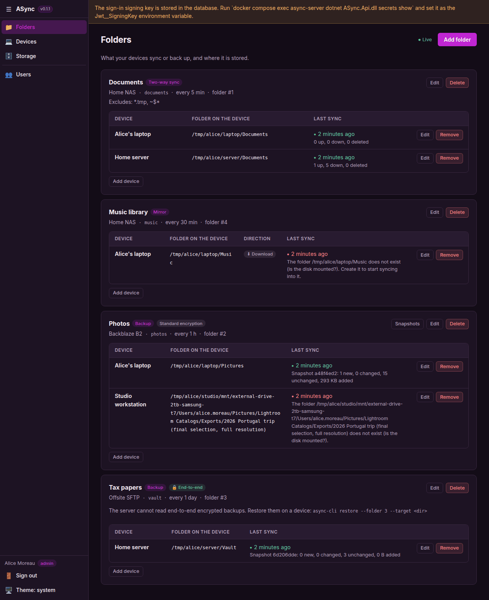
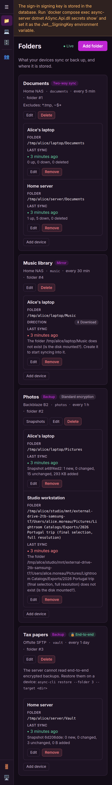

# ASync

Self-hosted sync and backup for all your devices: Windows, macOS, Linux, iOS and Android. One server, many
users, each with their own storage: local disk, S3-compatible, WebDAV/Nextcloud, SFTP or SMB.

> **Status: early development.** The server, the web UI (folders, devices, storage, snapshot browsing) and the
> headless CLI agent work: devices sync and back up folders through the server today. The desktop and mobile
> apps are next. The current version is in [VERSION](VERSION), changes are in
> [RELEASE_NOTES.md](RELEASE_NOTES.md), and the design, roadmap and known gaps are in [AGENTS.md](AGENTS.md).

<p>
  
  
</p>

## What works today

- **Accounts:** the first account becomes admin, and admins create the others. Optional single sign-on
  through any OpenID Connect provider (Authentik, Keycloak, Entra ID…).
- **Adding devices:**
  - **Phones and computers:** *Devices → Add device* shows a QR code and a short code. Scan it or type it in
    the app.
  - **Servers and CLI agents:** the agent prints a short code and a link. Open the link, check the code and
    approve.
  - **Scripted installs:** make a reusable code (valid up to 30 days) and give it to many agents.
- **Device security:**
  - Each device has its own key pair, and the private key never leaves the device (it is hardware-backed
    where the OS supports it).
  - Removing a device in the web UI cuts it off immediately.
- **Storage:** each user adds where their data goes: S3-compatible (AWS, Backblaze B2, Cloudflare R2, Wasabi,
  MinIO…), WebDAV/Nextcloud, SFTP or SMB.
  - Admins can also add directories on the server itself and shared storage. Each user gets their own area
    on shared storage.
  - Connections are tested before saving.
  - Passwords and keys are stored encrypted and never shown again.
- **Folders in the web UI:** *Folders* lists what is synced or backed up, where it is stored, and how each
  device's last sync went. The list updates live as devices report.
  - Add and edit folders (Backup, Mirror or two-way), then attach devices with their local folder. Mirror
    folders also get a direction for each device. Devices can be paused.
  - If someone else changed a folder while you were editing it, you are asked to reload instead of
    overwriting their change.
  - End-to-end encrypted folders show the command that sets them up on a device.
  - Backup folders show when their space was last freed and when they were last verified. A failed
    verification is shown in red with what was found.
- **Restoring from the browser:** for Backup folders with standard encryption, *Snapshots* lists every
  backup. Walk through its folders and download single files or whole folders as a ZIP. End-to-end encrypted
  backups can only be read on your devices: restore them with `async-cli restore`.
- **Web UI:** a sidebar layout with light, dark and system themes, usable on phones too.
  [More screenshots](docs/screenshots/): [snapshot browser](docs/screenshots/light-03-snapshots.png),
  [devices](docs/screenshots/light-06-add-device-qr.png), [storage](docs/screenshots/dark-08-storage.png),
  [phone menu](docs/screenshots/phone-02b-sidebar-open.png).
- **Sync engine** (used by the CLI agent today, and by the apps to come):
  - **Backups:** deduplicated, compressed, always encrypted snapshots, with retention rules. Old snapshots
    are dropped after each backup.
  - **Housekeeping, without anyone asking:** the space of dropped snapshots is freed (pruned) every 7 days,
    and every 30 days the backups are verified: that nothing is missing, and that a sample of the stored data
    (10%) still reads back correctly. Both schedules and the sample size are set per folder in the folder
    form; 0 days turns one off.
    - The server does this for folders with standard encryption.
    - For end-to-end encrypted folders one of the folder's devices does it (a running `async-cli run` that
      has the folder unlocked), because only devices have the key.
    - Either waits while a backup or a download is using the folder, and tries again later.
  - **Mirror and two-way folders:** stored as normal files, with old versions and a trash.

## Known limits

- **Keep a database backup.** Backups with standard (Transport) encryption can only be opened with a key the
  server keeps in its PostgreSQL database. If the database is lost, so are those backups. End-to-end
  encrypted backups do not depend on the server: the passphrase or the recovery key opens them.
- A failed verification is shown on the *Folders* page only: nobody is notified. Look there from time to
  time, or run `async-cli check` from a scheduled job and use its exit code.
- A scheduled verification reads back only a sample of the data. `async-cli check --read-data 100` reads
  all of it.
- End-to-end encrypted folders are only pruned and verified while one of their devices runs `async-cli run`
  with the folder unlocked.
- Devices that share a Backup folder need roughly correct clocks (within half an hour). A device whose clock
  is far off can take a running backup's lock for an abandoned one.
- Nobody is told when a device stops backing up.
- Mirror and two-way folders have no file, version or trash browser in the web UI yet.
- Very large files in Mirror and two-way folders are uploaded in one piece, with no resume; on S3 storage
  files over 5 GB fail.

The planned fixes are listed in [AGENTS.md](AGENTS.md) under "Before M3: gaps to close".

## Run it

```bash
docker compose up -d --build
```

Open http://localhost:5100 and create the admin account. Settings are environment variables on the
`async-server` service, documented inline in [docker-compose.yml](docker-compose.yml):

| Variable | Purpose |
|---|---|
| `PublicUrl` | Address devices use to reach the server (QR codes, approval links). Set it behind a reverse proxy. |
| `TrustForwardedHeaders` | `true` behind a reverse proxy, so client IPs and `https` are seen correctly. |
| `Jwt__SigningKey` | Key that signs sign-in tokens (32+ random characters). Unset = generated and stored in the database, with a warning. |
| `Oidc__Authority`, `Oidc__ClientId`, `Oidc__ClientSecret` | Turn on single sign-on. Redirect URI: `{PublicUrl}/api/auth/oidc/callback`. |
| `Oidc__DisplayName` | Text on the sign-in button. |
| `Oidc__AutoCreateUsers` | `true` (default): a new SSO user gets an account on first sign-in. |
| `Storage__LocalRoots` | Where admins may create back-ends on the server's own disk (default `/data`, the `async_data` volume). Comma-separated. |
| `Maintenance__PollSeconds` | How often the server looks for Backup folders due for pruning or verifying (default 900). |
| `Maintenance__Enabled` | `false` stops the server from pruning and verifying on its own. |

To move a generated signing key into the environment:

```bash
docker compose exec async-server dotnet ASync.Api.dll secrets show
```

Always put the server behind HTTPS (a reverse proxy such as Caddy or Traefik) before devices connect over
the internet.

## Run an agent

`async-cli` is the headless agent for servers, NAS boxes and other machines without a screen. It syncs and
backs up the folders you assign to it in the web UI.

### In Docker

Make a code in *Devices → Add device* (a reusable one works for many agents), then:

```bash
docker run -d --name async-agent --restart unless-stopped \
  -e ASYNC_SERVER=https://sync.example.com \
  -e ASYNC_ENROLL_CODE=K7QD-M2XP-9RWA \
  -e ASYNC_DEVICE_NAME=nas \
  -v async-agent-config:/config \
  -v /srv/photos:/data/photos \
  <dockerhub-user>/async-cli:latest
```

On first start the agent enrolls itself; after that the code is no longer needed. Then attach folders to the
device in the web UI, with local paths as the container sees them (`/data/photos`). The image is built from
[Dockerfile.cli](Dockerfile.cli) for amd64 and arm64; there is a commented-out `async-cli` service in
[docker-compose.yml](docker-compose.yml) as well.

- **Keep the `/config` volume.** It holds the device's key, unlocked end-to-end keys and the sync state.
  Without it the agent has to be enrolled again.
- The agent runs as uid 1654. Mounted folders must be readable by it, and writable for TwoWay folders and
  Mirror folders that download. Or run it as your own user with `--user $(id -u):$(id -g)`.

### Without Docker

Build it with the .NET 10 SDK (`dotnet publish src/ASync.Cli -c Release -o ~/async-cli`) and run
`~/async-cli/async-cli`. Its identity lives in `~/.config/async`, or in `ASYNC_CONFIG_DIR`, or in `--config <dir>`.

```bash
async-cli enroll --server https://sync.example.com --code K7QD-M2XP-9RWA   # or without --code: approve a link
async-cli run                                                                # keep syncing (Ctrl+C stops)
```

### Commands

| Command | What it does |
|---|---|
| `enroll` | Adds this machine to your account: with `--code`, or by showing a link and code to approve in the web UI. |
| `status`, `folders` | This device, and the folders assigned to it. |
| `sync [--folder N]` | Syncs (or backs up) every folder, or one, once. |
| `run` | Keeps syncing: on schedule, when files change, and as soon as another device changes a folder. The default in Docker. |
| `set-path`, `pause`, `resume` | Changes this device's settings for a folder. |
| `init-encryption --folder N` | Sets up an end-to-end encrypted Backup folder (on one device) and prints its recovery key. |
| `unlock --folder N` | Unlocks an end-to-end encrypted folder on another device, with the passphrase or the recovery key. |
| `snapshots`, `restore` | Lists a Backup folder's snapshots, and restores one (or `--path` a part of it) into `--target`. `--snapshot` takes the short id that `snapshots` and the web UI show (the id's last 8 digits), the start of the id, or `latest`. |
| `prune [--folder N]` | Frees the space of dropped snapshots in a Backup folder (or in all of this device's) now, and says what was removed and how much was freed. |
| `check [--folder N] [--read-data <percent>]` | Verifies a Backup folder (or all of this device's): nothing missing, and with `--read-data` that this share of the stored data reads back correctly (100 = everything). Lists the problems and exits with code 1 when it finds any. |
| `forget` | Removes this device's identity from the machine. |

Passphrases are read from `ASYNC_PASSPHRASE`, from `--passphrase-file`, or typed in. A sync that would delete
more than half of a folder's files stops; run it with `--allow-mass-delete` if that is what you want. Removing
the device in the web UI cuts it off at once: a running agent stops with an explanation. `prune` and `check`
work on standard and end-to-end folders alike; their results appear on the *Folders* page. Both say "BUSY"
and exit with code 1 when a backup or another prune is using the folder: run them again later.

## Development

See [CLAUDE.md](CLAUDE.md) for commands and rules, and [AGENTS.md](AGENTS.md) for the architecture.
`scripts/e2e-sync.sh` runs the end-to-end sync test: a throw-away server stack on port 5190 and real agents.
